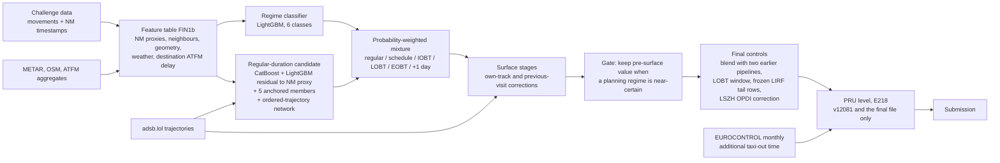

# PRC Data Challenge 2026: team gentle-igloo

We predict the **recorded taxi-out time** of departures at ten European airports
(EDDF, EDDM, EGLL, EHAM, LEBL, LEMD, LFPG, LIRF, LSZH, LTFM) for the
[EUROCONTROL PRC Data Challenge 2026](https://prc-data-challenge-2026.netlify.app/).
The models are trained on all 2025 departures (2,085,047 rows) and scored on
344,841 departures from January and July 2026.

**Best submission: `gentle-igloo_v12081.parquet`, RMSE 230.4478 s** (scored
11 October 2026). This is our best of 117 submissions; on 11 October 2026 at
08:52 UTC it ranked 18th of 242 teams. Our first submission scored 501.23 s.
v12081 is v12077 (230.4812 s, 8 October) with one post-mixture stage added, E218:
per airport and month it moves the predictions half-way towards the additional
taxi-out time that EUROCONTROL publishes for that month, outside de-icing months
(−0.0334 s). The rule was fixed and passed a gate on 2025 data before the upload;
its input is a published aggregate of the scored months (disclosed in
[final submission §2.5](docs/final-submission.md#25-e218-pru-level-stage)).
v12077 itself is the v12075 chain (230.9387 s, 7 October) with two changes: the neural
member is the mean of ten seeds instead of three (seeds 3–9 trained on the same frozen
inputs; no other model was refitted), and its weight
in the regular candidate rises from 0.25 to 0.35, the five anchored members
scaled by 0.65/0.75. The weight was chosen on 2025 out-of-fold data before the
upload (lower than 0.25 in all twelve months); the board confirmed it with
−0.4575 s against v12075 in two steps (v12076 −0.1204 s for the seeds, v12077
−0.3371 s for the weight). The blind final on four months (January, February,
June and July 2026) is a separate single file built by one uniform recipe; see
[final submission](docs/final-submission.md).

Code: [GNU GPLv3](LICENSE). Data keep their own terms, summarised below and in
[SOURCES.md](SOURCES.md).

### Data openness at a glance

| Input | Licence or terms | Status for the challenge |
|---|---|---|
| Challenge movements and NM records | Provided by the organiser to all teams | Challenge data |
| adsb.lol `globe_history` 2025 and 2026 | ODbL 1.0 | Open licence; also accepted by the organiser on 17 Sep 2026 |
| OpenStreetMap (via Overpass) | ODbL 1.0 | Open licence |
| Iowa Environmental Mesonet METAR archive | Public domain (IEM statement) | Open |
| ansperformance.eu daily arrival ATFM delay by airport | Portal terms: free with attribution, non-commercial | Accepted as open data for the challenge by the organiser on 17 Sep 2026 |
| OPDI v0.0.2 events (LSZH correction only) | No separate dataset licence published | Accepted as open by the organiser on 4 Oct 2026 |
| EUROCONTROL monthly taxi-out additional time per airport, 2025 and 2026 (E218 stage only: v12081 and the final file) | No open licence stated; portal terms: copying with attribution, non-commercial | Use answered "yes" by the organiser on 27 Sep 2026 (our question) and confirmed for the 2026 file on 8 Oct 2026; the 2026 values are a published aggregate of the scored months |
| TabPFN-2 classifier weights | [Prior Labs License 1.1](https://github.com/PriorLabs/TabPFN/blob/main/LICENSE) (Apache 2.0 plus an attribution clause) | Used for 42 tail predictions in v12075 and for every row of the Rome tail in the final file; weights are not redistributed. Built with PriorLabs-TabPFN |

The organiser's statements are quoted with dates in
[organiser clarifications](docs/organiser-clarifications.md). If any of the
EUROCONTROL inputs were set aside, the affected parts are the destination
ATFM delay features (leaderboard effect when added: −0.17 s), the half-weight
LSZH correction (−0.25 s over two steps) and the E218 PRU level stage (−0.0334 s
on v12077, −0.0360 s on the final file's January/July rows); the rest of the chain
does not use them.

## Contents

| Document | What it covers |
|---|---|
| [Model design](docs/model-design.md) | Every stage of the submitted chain, with weights and equations |
| [Development history](docs/development-history.md) | Which design decisions moved the leaderboard score, step by step |
| [Data insights](docs/data-insights.md) | Properties of the data that shaped the design, with figures |
| [Validation](docs/validation.md) | Cross-validation scheme, integrity checks, evidence for current members |
| [Negative results](docs/negative-results.md) | Ideas we tested and rejected, with measured effects and lessons |
| [Generalisation](docs/generalisation.md) | How the model performs on February and June (the final's new months), from 2025 out-of-fold predictions |
| [Uncertainty](docs/uncertainty.md) | A calibrated predictive distribution per flight from the regime mixture |
| [Data quality for PRU](docs/data-quality-regimes.md) | The regime classifier as a detector of block times copied from planning timestamps, and its effect on the PRU taxi-out indicator |
| [PRU view](docs/pru-view.md) | Predictions expressed as unimpeded reference plus additional taxi-out time |
| [Final submission](docs/final-submission.md) | The blind four-month final: rules, the uniform recipe, why it differs from v12075 and what that costs, ADS-B coverage of the new months, pipeline scripts and receipts, validation |
| [Model card](docs/model-card.md) | Intended use, inputs, training data, evaluation, limitations, data and licence considerations, maintenance |
| [Final submission runbook](docs/final-submission-runbook.md) | How the single four-month final file is validated and uploaded |
| [Paper draft](paper/README.md) | Draft article for the Journal of Open Aviation Science |
| [Reproduction](docs/reproduction.md) | How to verify and rebuild the submission; what is and is not yet portable |
| [Glossary](docs/glossary.md) | Plain-language names for experiment IDs such as E25 or E141 |
| [Sources and licences](SOURCES.md) | External data, licences, organiser clarifications |
| [Organiser clarifications](docs/organiser-clarifications.md) | Dated organiser statements on data use and evaluation |
| [Experiment register](HYPOTHESES_LOG.md) | Entries numbered 1–400 from 23 September to 8 October with method, result and verdict (in Russian); earlier experiments are in `REVIEW_BRIEF.md` |

## The problem as the data presents it

The target is `TAXITIME_SEC_mvt` = take-off time minus recorded off-block time.
In the ranking file only the departure off-block time and the target are hidden.
Take-off time, the Network Manager (NM) timestamps of the flight (scheduled,
initial, latest and estimated off-block, and the minute-rounded actual off-block
`AOBT_3`), the stand, the runway and all arrivals remain visible. This makes the
task a **retrospective reconstruction of when the aircraft left the stand**, not
a forecast made before pushback.

Three properties of the data drove the design (details and figures in
[data insights](docs/data-insights.md)):

1. **The label follows several recording regimes.** 6.8% of 2025 labels coincide
   (within 6 s) with take-off minus a planning timestamp (schedule, IOBT, LOBT or
   EOBT). At most airports many of these are simply on-time pushbacks, but at Rome
   (LIRF) the planning time replaces the real one: 18.1% of LIRF block times fall
   in the scheduled minute against 1.3–3.7% in the neighbouring minutes, and 83.7%
   of LIRF labels longer than one hour match a planning time. Fourteen labels are
   shifted by one day. The schedule class is 4.4% of rows but 28.0% of the label's
   squared deviation from its mean, so a single regressor fails exactly where RMSE
   is decided.
2. **The NM actual off-block `AOBT_3` is a strong but noisy anchor.** It exists
   for 98.9% of departures and is rounded to the minute. Take-off minus `AOBT_3`
   alone scores 384.9 s RMSE on 2025 (a constant scores 546.4 s), with an
   airport-specific offset: the median error is −118 s at LIRF and +296 s at LTFM.
3. **The aircraft's own ADS-B ground track shows when it actually started
   moving**, but coverage differs by airport and changed between the training
   and ranking months: LIRF had a surface track for 93.9% of departures in July
   2025 and 6.2% in July 2026; LTFM has practically none in either year.

In out-of-fold predictions for 2025, LIRF holds 7.7% of rows and 30.8% of the
squared error, and the 1.1% of rows without an NM flight record hold 36.6%.

## How the model works

1. **Recording-regime mixture.** A multiclass LightGBM estimates the probability
   of six regimes: a regular taxi, the label equal to take-off minus the schedule,
   IOBT, LOBT or EOBT, and a one-day shift. Each regime has a candidate value; the
   prediction is the probability-weighted mean, which is the right target under
   squared error when the probabilities are calibrated.
2. **Regular-duration candidate.** Gradient-boosted trees (CatBoost and LightGBM)
   learn the residual to a calibrated NM proxy (take-off minus `AOBT_3`, else LOBT,
   else EOBT). Five more LightGBM members add diversity: one learns the raw target,
   four learn it relative to the LOBT, schedule, EOBT and `AOBT_3` anchors. A neural
   network extends a numerical-embedding MLP with the ordered ADS-B observations
   of the current and previous visit of the same aircraft; in v12077 and the final
   recipe it is the mean of ten seeds at weight 0.35 (three seeds at 0.25 in v12075).
3. **Surface stages.** Where the flight's own ground track exists, gradient-boosted
   stages correct the estimate using movement onset, stops, stand distances and
   the previous visit of the aircraft. A gate leaves the prediction unchanged when
   the classifier is at least 95% sure the label is a planning timestamp, because
   physical movement cannot explain such a label.
4. **Sparse Rome tail.** LIRF departures without an NM match have few examples
   and very different possible values (minutes or hours). Their regime
   probabilities come from a TabPFN-2 classifier with airline prefix and local
   date. 42 of these predictions are frozen from an earlier run, because TabPFN is
   not deterministic between runs.
5. **Final controls.** A fixed blend with two earlier complete pipelines
   (per-airport models and an earlier global chain; weights 0.1214 and 0.0270,
   chosen by cross-validation), an adjustment and clip at the edge of the window
   implied by the LOBT timestamp, and a 50% blend with a small correction from
   OPDI surface events at Zurich only.
6. **PRU level (E218; v12081 and the final file).** Per airport and month, the
   additional taxi-out indicator implied by the predictions is compared with the
   value EUROCONTROL publishes for that month, and the predictions move by half the
   gap (net of the airport's 2025 emulation offset). Months in which PRU excluded
   de-iced flights are left unchanged. The published values for the scored months
   are an input here; see [final submission §2.5](docs/final-submission.md#25-e218-pru-level-stage).

The [model-design document](docs/model-design.md) gives the exact weights and
stage order; the [glossary](docs/glossary.md) maps every experiment ID to a
plain-language name.

## Beyond the leaderboard

- **A data-quality detector for the PRU taxi-out indicator.** The regime classifier is calibrated
  (mean probability 9.46% against 9.58% labelled planning-time copies across the seven labelled
  airports). Our emulation of the PRU additional taxi-out indicator matches the published 2025
  values from April to October (MAE 3.3 s, correlation 0.999), and copied block times inflate the
  LIRF indicator by about 42 s per departure. Details in [data quality for PRU](docs/data-quality-regimes.md).
- **Generalisation to the final's new months.** On 2025 out-of-fold predictions, February and June
  are not harder than January and July (RMSE 247.3 s against 279.2 s; on labels up to 7,200 s,
  196.3 s against 211.2 s), and the model beats the NM-proxy baseline in all 120 airport-months.
  See [generalisation](docs/generalisation.md).
- **Calibrated uncertainty.** Central 50/80/90% intervals from the regime mixture cover
  51.0/80.1/89.7% of 2025 out-of-fold departures. See [uncertainty](docs/uncertainty.md).

## Final blind ranking

The organiser announced on 8 October 2026 a single blind final on January, February,
June and July 2026 (670,790 departures), ranked on the initial two months, the new
two months and all four ([organiser clarifications](docs/organiser-clarifications.md)).
Our final file is built by the v12075 chain run once over all four months, with two
leaderboard-specific parts removed: the whole-file blend with two archived
January/July submissions (E81) and the 42 frozen TabPFN tail rows, replaced by a
fresh ten-seed TabPFN-2 ensemble on every row of the Rome tail. The neural member
is the mean of ten seeds instead of three (a variance reduction with no new
capacity; the two means differ by RMS 24.0 s on the final rows) and enters at
weight 0.35 instead of 0.25, with the five anchored members scaled by 0.65/0.75
(`WEIGHTS['final']`, journal 425). The weight was chosen on 2025 out-of-fold
predictions of the exact chain: 0.35 is the only grid value with lower squared
error than 0.25 in all twelve months, at three and at ten seeds. Both changes were
then scored on the leaderboard as v12076 and v12077 (−0.4575 s together against
v12075). Run as a canary on January/July with the old members and the old weights,
the uniform recipe scored 232.1933 s against 230.9387 s for v12075. On 9 October the
two removals were priced one at a time on the v12077 chain: dropping E81 costs
+0.5676 s (v12078, 231.0488 s) and the fresh tail ensemble instead of the frozen rows
+0.6958 s (v12079, 231.1770 s), +1.2634 s together against the canary's +1.2546 s.
That cost is accepted so that one procedure covers all months.

The file was first assembled on 9 October 2026 (SHA-256 `76c32426…d554`, 670,790
rows, no model fitted during assembly, all validator hard checks passed, an
independent rebuild from scratch gave the same SHA-256). Its January/July rows,
uploaded as the control v12080, scored 231.1805 s: 0.02 s below the corridor
written beforehand ([231.2; 232.3]). Under the rule registered with the forecast
the final upload was paused until the deviation was explained; a stage-by-stage
analysis without labels traced it mainly to the regime probabilities of the
refitted classifier on about 350 rows, within a noise of ±0.43–0.55 s, and the recipe was
not changed. The corridor had been about half as wide as that noise.

On 11 October one post-mixture stage was added, E218 (PRU level). It passed a gate
registered before it ran on the 2025 out-of-fold chain (6 of 6 month pairs, −0.137 s
pooled, both forward-in-time legs and 12 of 12 months), then had to beat v12077 by at
least 0.03 s in one upload under a rule written beforehand: v12081 scored 230.4478 s,
−0.0334 s, about half the forecast.
The final file was rebuilt with the stage: `gentle-igloo_final.parquet`, SHA-256
`bbae2cc544989a0faf68abb85dbb4a9aab5ea38eec98d01fa9282c332b4234a1`, 670,790 rows,
no model fitted, the stages before the new one identical to the 9 October build,
415,697 rows moved by RMS 4.7 s, all validator hard checks passed, rebuilt from
scratch with the same SHA-256. Its January/July rows, uploaded as the control
v12082, scored 231.1445 s, −0.0360 s against v12080 and inside the corridor written
beforehand, so under the registered rule this file is the final. A third upload,
v12083, removed the stage on the Rome (LIRF) rows only and scored 231.1749 s: of the
−0.0360 s, the two LIRF cells carry −0.0304 s and the other ten cells −0.0056 s, so
the 2025 relation transfers only partly and mostly at LIRF; under its rule the LIRF
cells stay. The stage reads
EUROCONTROL's published monthly additional taxi-out time for the scored months, an
aggregate of the same kind of record as the labels; the organiser confirmed the file
may be used, and the disclosure is in
[final submission §2.5](docs/final-submission.md#25-e218-pru-level-stage). The final
upload is planned for 12 October 2026; blind result:
`[[to be filled after 14 October]]`. Recipe, receipts, validation and fallbacks:
[final submission](docs/final-submission.md); a standard
[model card](docs/model-card.md) states intended use and limitations.

## What moved the score

111 uploads between 13 September and 8 October produced 63 new best scores.
Six more on 9 and 11 October priced and checked the final recipe; one of them,
v12081 (the E218 stage), is the 64th new best. The table groups the steps into the
phases described in the [development history](docs/development-history.md), which
lists every step with its evidence.

| Phase | Dates | Best RMSE | Design changes that moved the score (leaderboard gain) |
|---|---|---|---|
| 1. Recording-regime mixture | 13 Sep | 501.2 → 339.2 | Probability-weighted mixture of a "label = schedule" regime and a regressor (−135.0); six regimes and METAR (−12.0); OSM stand-runway geometry, hourly runway configuration and target encoding (−10.1); CatBoost + LightGBM (−4.8) |
| 2. NM residuals and the Rome tail | 14–15 Sep | 339.2 → 273.4 | Regressor learns the residual to the NM proxy, with neighbour features (−32.6); regime table for LIRF without NM (−27.0), then TabPFN-2 for the same rows (−4.7) |
| 3. Own-aircraft ADS-B stages | 15–19 Sep | 273.4 → 247.8 | First surface stage from adsb.lol ground tracks (−15.2); stand geometry (−3.7); NM proxy scaled per airport (−1.0); previous visit of the aircraft (−2.5); 1-knot movement threshold (−0.6) |
| 4. Filed-time neighbours and blends | 20–23 Sep | 247.8 → 242.3 | Neighbour features on filed times (−2.4); blends with two earlier complete pipelines (−0.8, −0.7); cost-weighted regime classifier (−0.5) |
| 5. Removing 2025-specific capacity | 24–27 Sep | 242.3 → 235.5 | Airline prefix for rows without NM (−0.4); stand identity and residual encodings removed (−0.7); airline prefix in the TabPFN tail (−3.6); CatBoost seed averaging (−0.8) |
| 6. Stage refinements and members | 28 Sep – 4 Oct | 235.5 → 232.6 | Members anchored to LOBT, schedule and raw target (−1.0); MLP member (−0.4); final feature table, planning-regime gate and several smaller steps |
| 7. Neural members with trajectories | 5–8 Oct | 232.6 → 230.5 | Piecewise-linear numerical embeddings (−0.54); ordered ADS-B observations of the current and previous visit (−0.51); the neural member as a mean of ten seeds (−0.12) and its weight raised from 0.25 to 0.35 (−0.34) |
| 8. Pricing the final recipe; PRU level | 9–11 Oct | 230.48 → 230.45 | E218: half the gap to EUROCONTROL's published monthly additional taxi-out time, outside de-icing months (−0.03); five further uploads priced or checked the final file and were not candidates for best |

Each gain is against the previous best file; where an upload bundled changes, the
development history gives the single-change control.

## How we validated

- **Six temporal folds** of 2025: two months six apart (1+7, 2+8, ..., 6+12)
  are held out together and the model trains on the other ten, mirroring the
  January + July ranking set.
- **Pre-registered gates.** Before each experiment we recorded the decision rule
  (for example: lower paired squared error in at least 4 of 6 folds, and not driven
  by a few rows). From 20 September most uploads also carried a leaderboard
  forecast written before the upload.
- **Every idea is logged**, including the rejected ones: entries 1–459 in
  [HYPOTHESES_LOG.md](HYPOTHESES_LOG.md) since 23 September, earlier ones in
  `REVIEW_BRIEF.md`; the most informative rejections are
  summarised in English in [negative results](docs/negative-results.md).
- **What we learned about transfer.** Rule-like changes that add no learned capacity
  carried over to the leaderboard reliably; added learned capacity often helped in
  cross-validation and not on the leaderboard. See
  [development history](docs/development-history.md).

There is no fully nested cross-validation of the exact final chain: some later
stages were trained on historical out-of-fold predictions of earlier ones. The
[validation document](docs/validation.md) states what each result does and does
not establish.

## Reproducing the submission

| Level | Status | Entry point |
|---|---|---|
| Verify the submitted files | v12081: SHA-256 `71962226…2f4c`; v12077: `f06c66bf…ba44`; v12075: `90d3cd0b…aee2`; 344,841 unique IDs each. Final file: `bbae2cc5…34a1`, 670,790 IDs | [docs/reproduction.md](docs/reproduction.md) |
| Rebuild v12075 from archived features, member predictions and saved models | Done independently on 7 October 2026: all predictions and Parquet bytes identical, no model refits, 101 s | `scripts/reproduce_v12075_v2.py` |
| Rebuild v12077 from the same archived components plus the ten-seed neural member | Done on 8 October 2026 on the same replay path: v12076 (ten-seed member, 1 min 57 s) then v12077 (E212 weights, 1 min 38 s), no model refits; the seven extra seeds were fitted on the frozen E203 pack with every checkpoint replayed exactly | `scripts/v12076_nn10seed_build_20261008.py`, `scripts/v12077_nn035_build_20261008.py` |
| Rebuild v12081 (v12077 plus the E218 stage) | Done on 11 October 2026: the v12077 chain rebuilt byte for byte, then the E218 stage executed from the SHA-pinned patch; 1 min 59 s, no model refits | `scripts/v12081_e218_build_20261011.py` |
| Rebuild the final file | Done twice on the Mac on 11 October 2026 from the sealed contract with `E218_PRU_LEVEL=1`, same SHA-256 `bbae2cc5…`, no model refits (231 s). Byte-identical only on the build platform: a replay of the 9 October file on Linux ARM64 matched the first three stages and differed in 55 of the 62 TabPFN tail values | [docs/reproduction.md](docs/reproduction.md#2c-rebuild-the-final-file) |
| Retrain everything from raw data | Trainers, extractors and stage builders are in `src/` and `scripts/`, listed in order in the reproduction guide; a clean end-to-end run of the current recipe has not been completed | [docs/reproduction.md](docs/reproduction.md) |
| Apply to a new period | Not one command. The four-month final is built by dated scripts (feature workspace, 52 tabular fits with saved models, 10-seed neural member, daily ADS-B products, tail assembly, validator), each registered with receipts; the period-specific donor rows and blend are not used | [docs/final-submission.md](docs/final-submission.md) |

Large data, fitted models and submission files are not in Git. The archive
needed for the exact rebuild is about 5.2 GB (5,187,588,486 bytes); its 3,711
files and their hashes are listed in
[`analysis/reproduce_v12075_20261007/inventory_v2.json`](analysis/reproduce_v12075_20261007/inventory_v2.json).
Part of it cannot be redistributed (challenge data, OPDI extracts, tables that
embed challenge labels), so the complete archive is available to the organisers
on request.

Environment: the CPU stack (Python ≥ 3.12, Polars, LightGBM, CatBoost, TabPFN) is
locked in [`uv.lock`](uv.lock). The neural member was trained on an AMD Radeon
RX 7900 XTX with a separately pinned GPU stack
([`requirements-gpu.txt`](requirements-gpu.txt): PyTorch 2.13.0 + ROCm,
`rtdl_num_embeddings` 0.0.12). Replaying the archived submission needs neither.

Tests: `python -m unittest discover -s tests` runs 386 unit tests of the build,
upload and validation helpers in about 5 s without any data (2 skipped).

## Repository map

| Path | Content |
|---|---|
| `src/train.py` | Regime labels, regime classifier, regular-duration regressor, mixture |
| `src/build_final_table.py`, `src/features.py` | Feature tables, including FIN1b |
| `src/blend.py`, `src/catboost_reg.py` | Regular candidate: CatBoost/LightGBM blend and anchored members |
| `src/adsb_*.py` | adsb.lol download, extraction, off-block and visit features |
| `src/e141_apply.py`, `src/e64_apply.py`, `src/e64_visit_stage.py`, `src/e134_stage_cv.py` | Own-track surface stage (E141), previous-visit stage (E64) and their cross-validation |
| `src/e185_apply.py`, `src/e167_nm_window_rule.py` | Movement-only member for rows without LOBT (E185); LOBT-window regime rules (E167) |
| `src/e152_stage_gate.py`, `src/blend_submissions.py`, `src/lobt_edge_lift.py`, `src/protect_tabpfn_rows.py` | Final controls: planning-regime gate (E152), blend with earlier pipelines (E81), LOBT window, frozen tail rows |
| `src/e11_tabpfn.py`, `src/e118_tabpfn_prefix.py` | TabPFN tail model for LIRF without NM |
| `scripts/e190_numeric_embeddings.py`, `scripts/e197_trajectory_encoder.py`, `scripts/e203_trajectory_production.py` | Neural member |
| `src/e159b_apply.py` | LSZH OPDI correction (E159b) |
| `scripts/export_feature_importance.py` | Feature importance of the saved classifier and regressor |
| `scripts/today_submissions_20261006.py` | Stage order of the submitted chain |
| `scripts/reproduce_v12075_v2.py` | Exact rebuild of v12075 from archived components |
| `scripts/e203_rank_seeds3to9_20261008.py`, `scripts/v12076_nn10seed_build_20261008.py`, `scripts/v12077_nn035_build_20261008.py` | Seeds 3–9 of the neural member on the frozen E203 pack; zero-fit builds of v12076 and v12077 |
| `scripts/e218_pru_level_recheck_20261010.py`, `scripts/v12081_e218_build_20261011.py` | E218: diagnosis of the earlier PRU calibration, the 2025 gate and the board model; zero-fit build of the best submission v12081 |
| `scripts/final_tail_assembly_20261008.py`, `scripts/validate_final_submission.py`, `scripts/final_transport_20261009.py` | Final file: assembly of all stages from a sealed contract (E218 with `E218_PRU_LEVEL=1`), validator, single-PUT transport |
| `src/strict_oof_gate.py` | Integrity checks for out-of-fold artifacts |
| `scripts/make_doc_figures.py` | Figures in `docs/figures/` |
| `analysis/` | Dated experiment reports and evidence (mostly Russian) |
| `HYPOTHESES_LOG.md`, `REVIEW_BRIEF.md` | Experiment register and working brief (Russian) |

Most of the ~560 files in `src/` and `scripts/` are individual experiments kept
for traceability; their IDs match the register.

## Limitations

- The model reconstructs a **recorded** off-block time after the fact. It uses
  the take-off time and the flight's own post-pushback track, so it is not a
  pre-departure forecast.
- Ranking months were also used for development decisions through 117
  leaderboard submissions, so the leaderboard score carries selection effects.
  No submission was tuned row by row against the leaderboard.
- The E218 stage of v12081 and the final file reads EUROCONTROL's published
  monthly additional taxi-out time for the scored months, an aggregate of the same
  kind of record as the labels. Its rule was fixed on 2025 data, but its inclusion
  in the final was decided by leaderboard uploads. On January/July only part of the
  2025 relation transferred, most of it at Rome, where the largest shift of the
  blind months (+21 s in June) has not been measured.
- Results depend on ADS-B ground coverage, which differs by airport and year.
- A few extreme labels (multi-hour or one-day shifts) dominate RMSE; small changes
  in how they are hedged can move the score by more than a model improvement.

## Originality and prior work

The design is our own. Where an idea came from elsewhere we say so in the
[development history](docs/development-history.md): the first ADS-B surface stage
followed a technique seen in team merry-quicksand's public code (our
implementation); per-airport scaling of the NM proxy was also reported by team
elegant-alligator; ideas from other public repositories that we tested and
rejected are listed in [negative results](docs/negative-results.md). The
numerical embeddings follow Gorishniy, Rubachev and Babenko (NeurIPS 2022), and
the tail classifier is TabPFN-2 (Hollmann et al., Nature 2025).

## Team

Team gentle-igloo is one developer, Denys Kolomiiets
([@disclaimer8](https://github.com/disclaimer8)), working with AI coding
assistants. Every modelling decision, gate and upload is recorded with its
evidence in [HYPOTHESES_LOG.md](HYPOTHESES_LOG.md). The working notes in Russian
(`AGENTS.md`, `HANDOFF.md`, `REVIEW_BRIEF.md`, `hz_queue/`, `analysis/`) are kept
for traceability and are not needed to read or reproduce the model.

## Data acknowledgements

EUROCONTROL Performance Review Commission Data Challenge 2026, supported by the
OpenSky Network; [adsb.lol](https://adsb.lol) and its contributors (ODbL 1.0);
© OpenStreetMap contributors (ODbL 1.0); Iowa Environmental Mesonet, Iowa State
University; EUROCONTROL Performance Review Unit and the Open Performance Data
Initiative. TabPFN-2 weights by Prior Labs. Full terms in [SOURCES.md](SOURCES.md).
