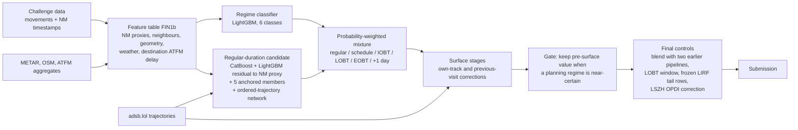

# PRC Data Challenge 2026: team gentle-igloo

We predict the **recorded taxi-out time** of departures at ten European airports
(EDDF, EDDM, EGLL, EHAM, LEBL, LEMD, LFPG, LIRF, LSZH, LTFM) for the
[EUROCONTROL PRC Data Challenge 2026](https://prc-data-challenge-2026.netlify.app/).
The models are trained on all 2025 departures (2,085,047 rows) and scored on
344,841 departures from January and July 2026.

**Best submission: `gentle-igloo_v12075.parquet`, RMSE 230.9387 s** (scored
7 October 2026). This is our best of 108 submissions; on 8 October 2026 it
ranked 14th of 237 teams. Our first submission scored 501.23 s.

Code: [GNU GPLv3](LICENSE). Data keep their own terms; see [SOURCES.md](SOURCES.md).

## Contents

| Document | What it covers |
|---|---|
| [Model design](docs/model-design.md) | Every stage of the submitted chain, with weights and equations |
| [Development history](docs/development-history.md) | Which design decisions moved the leaderboard score, step by step |
| [Data insights](docs/data-insights.md) | Properties of the data that shaped the design, with figures |
| [Validation](docs/validation.md) | Cross-validation scheme, integrity checks, evidence for current members |
| [Negative results](docs/negative-results.md) | Ideas we tested and rejected, with measured effects and lessons |
| [Reproduction](docs/reproduction.md) | How to verify and rebuild the submission; what is and is not yet portable |
| [Glossary](docs/glossary.md) | Plain-language names for experiment IDs such as E25 or E141 |
| [Sources and licences](SOURCES.md) | External data, licences, organiser clarifications |
| [Experiment register](HYPOTHESES_LOG.md) | All ~375 hypotheses with method, result and verdict (in Russian) |

## The problem as the data presents it

The target is `TAXITIME_SEC_mvt` = take-off time minus recorded off-block time.
In the ranking file only the departure off-block time and the target are hidden.
Take-off time, the Network Manager (NM) timestamps of the flight (scheduled,
initial, latest and estimated off-block, and the minute-rounded actual off-block
`AOBT_3`), the stand, the runway and all arrivals remain visible. This makes the
task a **retrospective reconstruction of when the aircraft left the stand**, not
a forecast made before pushback.

Three properties of the data drove the design (details and figures in
[data insights](docs/data-insights.md)):

1. **The label follows several recording regimes.** 6.8% of 2025 labels coincide
   (within 6 s) with take-off minus a planning timestamp (schedule, IOBT, LOBT or
   EOBT). At most airports many of these are simply on-time pushbacks, but at Rome
   (LIRF) the planning time replaces the real one: 18.1% of LIRF block times fall
   in the scheduled minute against 1.3–3.7% in the neighbouring minutes, and 83.7%
   of LIRF labels longer than one hour match a planning time. Fourteen labels are
   shifted by one day. The schedule class is 4.4% of rows but 28.0% of the label's
   squared deviation from its mean, so a single regressor fails exactly where RMSE
   is decided.
2. **The NM actual off-block `AOBT_3` is a strong but noisy anchor.** It exists
   for 98.9% of departures and is rounded to the minute. Take-off minus `AOBT_3`
   alone scores 384.9 s RMSE on 2025 (a constant scores 546.4 s), with an
   airport-specific offset: the median error is −118 s at LIRF and +296 s at LTFM.
3. **The aircraft's own ADS-B ground track shows when it actually started
   moving**, but coverage differs by airport and changed between the training
   and ranking months: LIRF had a surface track for 93.9% of departures in July
   2025 and 6.2% in July 2026; LTFM has practically none in either year.

In out-of-fold predictions for 2025, LIRF holds 7.7% of rows and 30.8% of the
squared error, and the 1.1% of rows without an NM flight record hold 36.6%.

## How the model works

1. **Recording-regime mixture.** A multiclass LightGBM estimates the probability
   of six regimes: a regular taxi, the label equal to take-off minus the schedule,
   IOBT, LOBT or EOBT, and a one-day shift. Each regime has a candidate value; the
   prediction is the probability-weighted mean, which is the right target under
   squared error when the probabilities are calibrated.
2. **Regular-duration candidate.** Gradient-boosted trees (CatBoost and LightGBM)
   learn the residual to a calibrated NM proxy (take-off minus `AOBT_3`, else LOBT,
   else EOBT). Five more LightGBM members add diversity: one learns the raw target,
   four learn it relative to the LOBT, schedule, EOBT and `AOBT_3` anchors. A neural
   network (weight 0.25) extends a numerical-embedding MLP with the ordered ADS-B
   observations of the current and previous visit of the same aircraft.
3. **Surface stages.** Where the flight's own ground track exists, gradient-boosted
   stages correct the estimate using movement onset, stops, stand distances and
   the previous visit of the aircraft. A gate leaves the prediction unchanged when
   the classifier is at least 95% sure the label is a planning timestamp, because
   physical movement cannot explain such a label.
4. **Sparse Rome tail.** LIRF departures without an NM match have few examples
   and very different possible values (minutes or hours). Their regime
   probabilities come from a TabPFN-2 classifier with airline prefix and local
   date. 42 of these predictions are frozen from an earlier run, because TabPFN is
   not deterministic between runs.
5. **Final controls.** A fixed blend with two earlier complete pipelines
   (per-airport models and an earlier global chain; weights 0.1214 and 0.0270,
   chosen by cross-validation), an adjustment and clip at the edge of the window
   implied by the LOBT timestamp, and a 50% blend with a small correction from
   OPDI surface events at Zurich only.

The [model-design document](docs/model-design.md) gives the exact weights and
stage order; the [glossary](docs/glossary.md) maps every experiment ID to a
plain-language name.

## What moved the score

108 uploads between 13 September and 7 October produced 61 new best scores.
The table groups them into the seven phases described in the
[development history](docs/development-history.md), which lists every step with
its evidence.

| Phase | Dates | Best RMSE | Design changes that moved the score (leaderboard gain) |
|---|---|---|---|
| 1. Recording-regime mixture | 13 Sep | 501.2 → 339.2 | Probability-weighted mixture of a "label = schedule" regime and a regressor (−135.0); six regimes and METAR (−12.0); OSM stand-runway geometry, hourly runway configuration and target encoding (−10.1); CatBoost + LightGBM (−4.8) |
| 2. NM residuals and the Rome tail | 14–15 Sep | 339.2 → 273.4 | Regressor learns the residual to the NM proxy, with neighbour features (−32.6); regime table for LIRF without NM (−27.0), then TabPFN-2 for the same rows (−4.7) |
| 3. Own-aircraft ADS-B stages | 15–19 Sep | 273.4 → 247.8 | First surface stage from adsb.lol ground tracks (−15.2); stand geometry (−3.7); NM proxy scaled per airport (−1.0); previous visit of the aircraft (−2.5); 1-knot movement threshold (−0.6) |
| 4. Filed-time neighbours and blends | 20–23 Sep | 247.8 → 242.3 | Neighbour features on filed times (−2.4); blends with two earlier complete pipelines (−0.8, −0.7); cost-weighted regime classifier (−0.5) |
| 5. Removing 2025-specific capacity | 24–27 Sep | 242.3 → 235.5 | Airline prefix for rows without NM (−0.4); stand identity and residual encodings removed (−0.7); airline prefix in the TabPFN tail (−3.6); CatBoost seed averaging (−0.8) |
| 6. Stage refinements and members | 28 Sep – 4 Oct | 235.5 → 232.6 | Members anchored to LOBT, schedule and raw target (−1.0); MLP member (−0.4); final feature table, planning-regime gate and several smaller steps |
| 7. Neural members with trajectories | 5–7 Oct | 232.6 → 230.9 | Piecewise-linear numerical embeddings (−0.54); ordered ADS-B observations of the current and previous visit (−0.51) |

Each gain is against the previous best file; where an upload bundled changes, the
development history gives the single-change control.

## How we validated

- **Six temporal folds** of 2025: two months six apart (1+7, 2+8, ..., 6+12)
  are held out together and the model trains on the other ten, mirroring the
  January + July ranking set.
- **Pre-registered gates.** Before each experiment we recorded the decision rule
  (for example: lower paired squared error in at least 4 of 6 folds, and not driven
  by a few rows). From 20 September we also wrote a predicted leaderboard score
  before each upload.
- **Every idea is logged**, including the rejected ones: about 375 entries in
  [HYPOTHESES_LOG.md](HYPOTHESES_LOG.md); the most informative rejections are
  summarised in English in [negative results](docs/negative-results.md).
- **What we learned about transfer.** Rule-like changes that add no learned capacity
  carried over to the leaderboard reliably; added learned capacity often helped in
  cross-validation and not on the leaderboard. See
  [development history](docs/development-history.md).

There is no fully nested cross-validation of the exact final chain: some later
stages were trained on historical out-of-fold predictions of earlier ones. The
[validation document](docs/validation.md) states what each result does and does
not establish.

## Reproducing the submission

| Level | Status | Entry point |
|---|---|---|
| Verify the submitted file | SHA-256 `90d3cd0b…aee2`, 344,841 unique IDs | [docs/reproduction.md](docs/reproduction.md) |
| Rebuild v12075 from archived features, member predictions and saved models | Done independently on 7 October 2026: all predictions and Parquet bytes identical, no model refits, 101 s | `scripts/reproduce_v12075_v2.py` |
| Retrain everything from raw data | Trainers, extractors and stage builders are in `src/` and `scripts/`; a clean end-to-end run of the current recipe has not been completed | [docs/reproduction.md](docs/reproduction.md) |

Large data, fitted models and submission files are not in Git. The archive
needed for the exact rebuild is about 5.1 GB and is listed in
[`docs/reproduction_manifest.json`](docs/reproduction_manifest.json).

Environment: Python 3.12 with the locked dependencies in
[`pyproject.toml`](pyproject.toml) / [`uv.lock`](uv.lock). The neural members were
trained with PyTorch on an AMD Radeon RX 7900 XTX (ROCm); everything else runs on
CPU.

## Repository map

| Path | Content |
|---|---|
| `src/train.py` | Regime labels, classifier, regular-duration regressor, mixture |
| `src/build_final_table.py`, `src/features.py` | Feature tables, including FIN1b |
| `src/blend.py`, `src/catboost_reg.py` | Regular candidate: CatBoost/LightGBM blend and anchored members |
| `src/adsb_*.py` | adsb.lol download, extraction, off-block and visit features |
| `src/e141_apply.py`, `src/e64_apply.py`, `src/e64_visit_stage.py`, `src/e134_stage_cv.py` | Surface stages (own track, previous visit) and their cross-validation |
| `src/e152_stage_gate.py`, `src/blend_submissions.py`, `src/lobt_edge_lift.py`, `src/protect_tabpfn_rows.py` | Final controls |
| `src/e11_tabpfn.py`, `src/e118_tabpfn_prefix.py` | TabPFN tail model for LIRF without NM |
| `scripts/e190_numeric_embeddings.py`, `scripts/e197_trajectory_encoder.py`, `scripts/e203_trajectory_production.py` | Neural member |
| `src/e159b_apply.py` | LSZH OPDI correction |
| `scripts/today_submissions_20261006.py` | Stage order of the submitted chain |
| `scripts/reproduce_v12075_v2.py` | Exact rebuild of the best submission |
| `src/strict_oof_gate.py` | Integrity checks for out-of-fold artifacts |
| `scripts/make_doc_figures.py` | Figures in `docs/figures/` |
| `analysis/` | Dated experiment reports and evidence (mostly Russian) |
| `HYPOTHESES_LOG.md`, `REVIEW_BRIEF.md` | Experiment register and working brief (Russian) |

Most of the ~560 files in `src/` and `scripts/` are individual experiments kept
for traceability; their IDs match the register.

## Limitations

- The model reconstructs a **recorded** off-block time after the fact. It uses
  the take-off time and the flight's own post-pushback track, so it is not a
  pre-departure forecast.
- Ranking months were also used for development decisions through 108
  leaderboard submissions, so the leaderboard score carries selection effects.
  No submission was tuned row by row against the leaderboard.
- Results depend on ADS-B ground coverage, which differs by airport and year.
- A few extreme labels (multi-hour or one-day shifts) dominate RMSE; small changes
  in how they are hedged can move the score by more than a model improvement.

## Data acknowledgements

EUROCONTROL Performance Review Commission Data Challenge 2026, supported by the
OpenSky Network; [adsb.lol](https://adsb.lol) and its contributors (ODbL 1.0);
© OpenStreetMap contributors (ODbL 1.0); Iowa Environmental Mesonet, Iowa State
University; EUROCONTROL Performance Review Unit and the Open Performance Data
Initiative. TabPFN-2 weights by Prior Labs. Full terms in [SOURCES.md](SOURCES.md).
