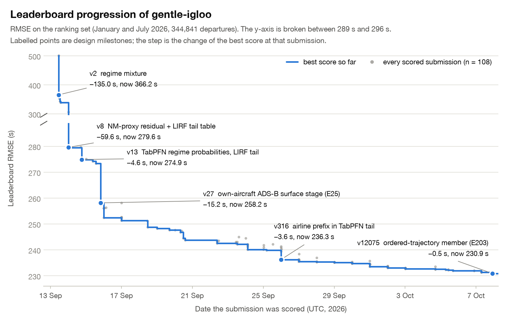
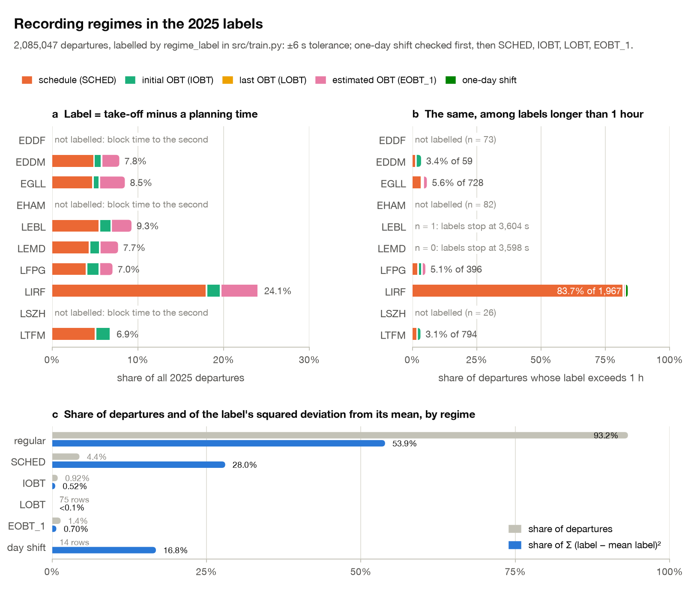
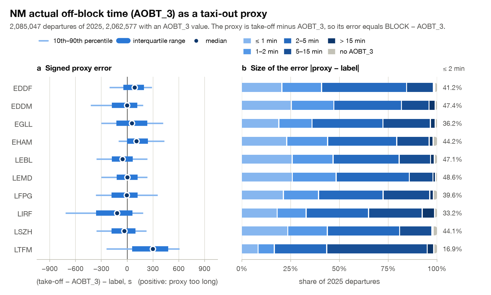
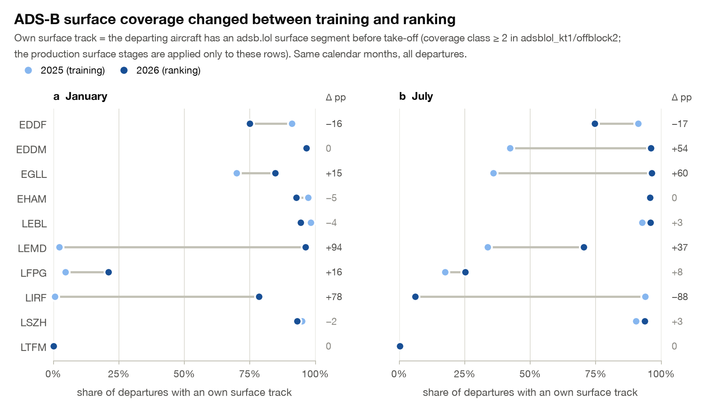
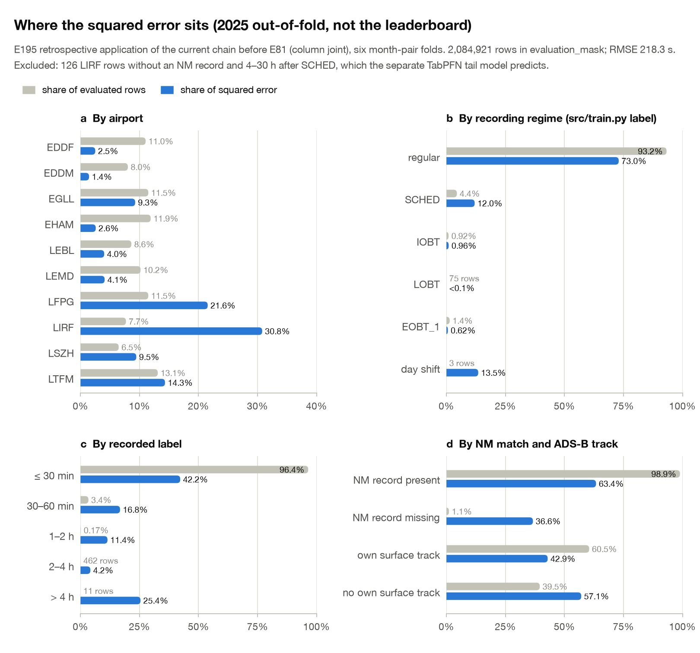

# Data insights behind the model design

This page shows five properties of the challenge data that shaped the model, one figure
each, plus the data caveats a reader should keep in mind. Every number on this page is
printed by [`scripts/make_doc_figures.py`](../scripts/make_doc_figures.py), which also draws
the figures, unless a link to another document is given. The
[model design](model-design.md) describes the final chain, and the
[development history](development-history.md) lists every leaderboard step.

Populations used below:

| Figure | Rows | Source |
|---|---|---|
| 1 | 108 scored submissions | [`docs/tables/leaderboard_gentle-igloo.csv`](tables/leaderboard_gentle-igloo.csv) |
| 2, 3 | 2,085,047 departures of 2025 | `training_*.parquet` |
| 4 | 344,419 departures (January and July 2025) and 344,841 (January and July 2026) | `training_*.parquet`, `ranking.parquet`, `adsblol_kt1/offblock2_<day>.parquet` |
| 5 | 2,084,921 out-of-fold predictions for 2025 | `e195_pre_e81_20261007_v2/predictions.parquet` |

## 1. Leaderboard progression



The best score fell from 501.23 s (v1, 13 September) to 230.94 s (v12075, 7 October).
Three steps did most of the work. Modelling how the label is recorded gave −135.0 s at v2.
The v8 step of −59.6 s combines two changes: v7, scored after v8 as a control at 306.58 s,
isolates −32.6 s from learning the residual to the NM off-block proxy with neighbour
features, and the remaining −27.0 s comes from the LIRF tail table. The own-aircraft ADS-B
surface stage gave −15.2 s at v27. Day-one feature and learner changes (v3 to v5, −27.0 s
together) are not labelled. After v316 (236.32 s) the last eleven days added 5.38 s.

**Design consequence.** The largest gains came from describing the recording process and
from a physical sensor, not from learner tuning. Sections 2 to 4 show the data behind those
three steps.

## 2. Recording regimes



The labels come from `regime_label` in [`src/train.py`](../src/train.py) with its registered
settings: ±6 s tolerance, and no planned regimes at EDDF, EHAM and LSZH, which record block
time to the second. In 2025, 140,993 labels (6.76 %) equal take-off minus SCHED, IOBT, LOBT
or EOBT_1, or lie between one day and one day plus two hours (one-day shift). The share is
24.1 % at LIRF and 6.9–9.3 % at the other six labelled airports (panel a). Among long labels
LIRF stands out further (panel b): 83.7 % of its 1,967 labels above one hour match a planning
time, against 3.1–5.6 % at the other airports with at least 20 such labels. A same-minute
test separates substitution from chance. At LIRF, 18.1 % of block times fall in the scheduled
minute, against 3.7 % in the minute before and 1.3 % in the minute after. At EDDM, EGLL,
LEBL, LEMD, LFPG and LTFM the scheduled minute holds 4.1–5.6 % against 3.5–5.3 % in its
neighbours. That is consistent with on-time off-blocks, whose planning-time candidate equals
the physical taxi time anyway. Panel c shows why the regimes dominate the metric:
the schedule class is 4.4 % of rows but holds 28.0 % of the squared deviation of the label
from its mean. The 14 one-day-shift labels hold 16.8 %.

**Design consequence.** A recording-regime mixture replaces a single regressor (v2): a
multiclass classifier weights the regular prediction against the take-off-minus-planning-time
candidates, and the prediction is their probability-weighted mean. LIRF rows without an NM
record and with a long delay get their own tail model (table at v8, TabPFN from v13).

## 3. The NM off-block proxy



The NM actual off-block time `AOBT_3_flt` is present for 98.92 % of 2025 departures, and
97.7 % of its values fall on a whole minute. Used directly, take-off minus `AOBT_3` gives an
RMSE of 384.9 s. A constant prediction gives 546.4 s. Of all proxy errors, 39.4 % are within
two minutes and 74.6 % within five. The error has an airport-specific offset: the median is
−118 s at LIRF, +87 s at EDDF, +107 s at EHAM and +296 s at LTFM, where only 16.9 % of
departures are within two minutes. The median absolute error is 121–184 s at nine airports and
356 s at LTFM.

**Design consequence.** The proxy is a strong anchor but not a label. The ordinary models
learn the residual to it (v7, −32.6 s) and fall back to LOBT and then EOBT_1 when `AOBT_3` is
missing or outside 0–7,200 s. The proxy is scaled per airport and per timestamp source; the fitted
`AOBT_3` scales are 0.80–1.16 ([development history](development-history.md), step 16). The
proxy cannot recover the off-block minute where NM itself is several minutes off. That
remaining error is what the ADS-B stages address.

## 4. ADS-B surface coverage drift



An own surface track means that the departing aircraft has an adsb.lol surface segment before
take-off: coverage class ≥ 2 in `adsblol_kt1/offblock2_<day>.parquet`, the extraction read by
the production surface stage E141. The default 3-kt extraction in `adsblol/`, used by
[`src/e146_stage_drift.py`](../src/e146_stage_drift.py), gives the same set of covered
departures (0 disagreements in either year). Over January and July the share rises from
53.8 % in 2025 to 64.9 % in 2026, but single airport-months move much more. LIRF goes from
0.6 % to 78.5 % in January and from 93.9 % to 6.2 % in July. LEMD January goes from 2.3 % to
96.3 %, EGLL July from 35.9 % to 96.3 %, and EDDF drops by 16–17 points in both months. LTFM
has practically no surface track in either year, and LFPG stays between 5 % and 25 %.

**Design consequence.** ADS-B enters as correction stages gated by coverage, not as base
features. E141 corrects only rows with an own track, and E64 corrects only rows without one
that have a previous visit of the same aircraft, so the two populations are disjoint. The
base model must stay accurate without any track. Seven reception-density features are
dropped from E141 and three from E64 because their historical behaviour did not transfer
reliably ([model design](model-design.md), "Surface observations").

## 5. Error budget



These are 2025 out-of-fold predictions, not leaderboard results. Column `joint` of
`e195_pre_e81_20261007_v2/predictions.parquet` is the E195 retrospective application of the
v12074 chain through E152, before E81 and the later steps of the submitted file. Its neural
member is E190, which v12075 replaced with E203. It reuses cached upstream probabilities
rather than refitting them
([`scripts/e195_pre_e81_comparison.py`](../scripts/e195_pre_e81_comparison.py)), so treat the
shares as indicative. `evaluation_mask` removes 126 LIRF rows without an NM record and 4–30 h
after SCHED. The separate TabPFN tail model predicts these rows, and its out-of-fold output is
not in this file. On the remaining 2,084,921 rows the RMSE is 218.3 s.

LIRF holds 7.7 % of rows and 30.8 % of the squared error, and LFPG 11.5 % and 21.6 %. EDDF,
EDDM and EHAM together hold 31.0 % of rows and 6.5 % of the error. Three one-day-shift rows
hold 13.5 %, and 11 labels above four hours hold 25.4 %. The 1.07 % of rows without an NM
flight record hold 36.6 %. Rows without an own surface track are 39.5 % of the data, hold
57.1 % of the error and have an RMSE of 262.3 s, against 183.8 s with a track (229.2 s against
145.4 s on labels up to 7,200 s). The ten largest errors make up 25.8 % of the total, and the
largest 1 % of rows make up 62.0 %.

**Design consequence.** The chain has a dedicated component wherever the error concentrates.
The LIRF tail without NM has its own TabPFN model. Rows without LOBT outside LIRF get a
movement-only member (E185). The ADS-B stages correct the start of taxi where a track exists.
On labels up to 7,200 s the largest airport errors after LIRF (363.5 s) are LTFM (224.2 s)
and LFPG (211.9 s): one has no surface tracks and the most biased proxy (Figures 3 and 4),
the other has tracks for at most a quarter of its departures. These are the open focus areas.
Validation reports RMSE on all rows next to RMSE on labels up to 7,200 s (183.2 s here; see
[validation](validation.md)), so that a handful of rows cannot hide a change in the body.

## Data caveats

- **Minute-rounded times.** 97.7 % of `AOBT_3` values fall on a whole minute. At EDDM, EGLL,
  LEBL, LEMD, LFPG, LIRF and LTFM at least 99.95 % of block times sit within ±6 s of a whole
  minute; at EDDF, EHAM and LSZH 21.7–24.9 % do, close to the 13/60 expected from uniform
  seconds. Take-off times follow the same pattern except at LEBL and LEMD, which record them
  to the second. The ±6 s regime tolerance follows from this. A label at those seven airports
  is therefore a difference of minute-resolution times with a few seconds of jitter.
- **Missing NM matches.** 1.08 % of 2025 departures have no NM flight record, and with it no
  `AOBT_3`, LOBT, IOBT or EOBT_1. The share is 1.56 % in January and July 2025 and 1.53 % in
  the ranking set, where it reaches 4.96 % at EHAM in January 2026. In the out-of-fold
  predictions these rows hold 36.6 % of the squared error.
- **Receiver network change.** ADS-B surface coverage per airport and month differs strongly
  between 2025 and 2026 (Figure 4). A model that learned where aircraft are heard, rather
  than how they move, would not transfer.
- **Extreme labels dominate RMSE.** In January and July 2025, 45 of 344,419 labels exceed
  four hours and hold 52.4 % of the label's sum of squared deviations from its mean. This is
  a model-free measure: the "52 % of squared error" quoted in earlier notes refers to it. In
  the current out-of-fold predictions, 41 of these 45 rows belong to the TabPFN tail segment
  outside `evaluation_mask`. The 4 that remain still hold 38.2 % of the January and July
  squared error. Over all of 2025 there are 122 labels above four hours, 111 of them in the
  tail segment.
- **Coincidence is not substitution.** Outside LIRF most matches between a label and
  take-off minus a planning time occur at the same rate as in the neighbouring minutes
  (Figure 2). The regime is therefore modelled as a probability, not as a hard rule.
- **Label ranges differ by airport.** Labels at LEBL and LEMD stop at 3,604 s and 3,598 s,
  while the other airports reach 6,899–131,167 s. 369 labels are negative. The
  regular-duration regressor clips its training target to 0–7,200 s (`REG_CLIP` in
  `src/train.py`); longer labels are left to the regime mixture and the tail model.

## Regenerate

From the repository root, with the challenge data and the derived tables under `data/`.
Figures 1–3 need only the repository and the challenge files. Figures 4 and 5 also need
derived tables that are not in Git: the daily surface extractions in `data/adsblol_kt1/`
(see [reproduction](reproduction.md)) and `data/e195_pre_e81_20261007_v2/predictions.parquet`.

```bash
.venv/bin/python scripts/make_doc_figures.py --data-root data
```

The script reads only the files listed in the table at the top. It trains no model, writes
the five PNG files to `docs/figures/`, and prints every number quoted here. Options: `--only 1,3`
draws a subset, `--out` changes the output directory, and a figure whose inputs are missing
is skipped with a message. The run takes a few seconds and about 2 GB of memory; repeated
runs produce byte-identical files. Recording-regime labels are imported from `src/train.py`
with the registered settings, so the figures use the same labels as the model.
