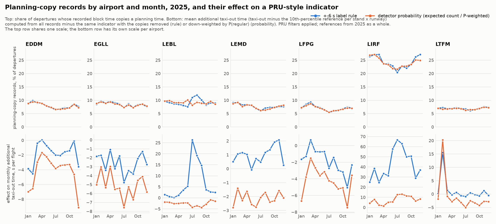

# Recording regimes as a data-quality signal for airport taxi-out statistics

Some departure records in the challenge data have a block time that coincides with a
planning timestamp (schedule, IOBT, LOBT, EOBT_1), or a duration consistent with a one-day
shift. We assign these records heuristic recording-regime labels. A planning-time match
can reflect substitution or a coincidental on-time departure. The regime classifier (`src/train.py`, described in
[model design](model-design.md#recording-regime-mixture)) estimates, per departure, the
probabilities of these labels. This page evaluates agreement with the labelling rule,
counts by airport and month, and the sensitivity of taxi-out statistics and a PRU-style
"additional taxi-out time" indicator to excluding or reweighting the labelled records.
The results do not count independently verified recording errors.

The original calibration and indicator results are computed by [`scripts/regime_quality_report.py`](../scripts/regime_quality_report.py)
from the production out-of-fold predictions of 2025 (`data/cv_preds_fin1b_hz`, six
month-pair folds, 2,085,047 departures; file hashes in
[`regime_quality_run.json`](tables/regime_quality_run.json)). No model is trained by the
script. Numbers in the text are rounded from the tables it writes. The additional registered
checks in section 3.1 use the separately linked scripts and dated result artifacts.

```
POLARS_MAX_THREADS=2 .venv/bin/python scripts/regime_quality_report.py --data-root data
```

## 1. What is being detected, and against which reference

- **Label (the +-6 s rule).** `regime_label` in `src/train.py`: a record is labelled non-regular
  when take-off minus the recorded block time equals take-off minus SCHED, IOBT, LOBT or
  EOBT_1 within +-6 s (first match wins, in that order), or when the label lies between one
  day and one day plus two hours (one-day shift). EDDF, EHAM and LSZH record block time to
  the second and show no plateau at the planning times, so planned regimes are not labelled
  there (only the one-day shift is; it occurs once, at LSZH). In 2025 the rule marks 140,993
  of 2,085,047 departures (6.76 %); the share is 24.1 % at LIRF and 6.9-9.3 % at the other six
  labelled airports.
- **Detector.** `P(non-regular rule label) = 1 - P(regular)` from the six-class classifier, out of fold
  (each month predicted by a model that never saw it). Class order: regular, sched, iobt,
  lobt, eobt, dayshift.
- **The label is a rule, not ground truth.** An on-time departure whose physical off-block
  happens to fall in the scheduled minute is labelled a copy although nothing was copied.
  [Data insights](data-insights.md#2-recording-regimes) shows that outside LIRF the
  scheduled minute holds 4.1-5.6 % of block times against 3.5-5.3 % in the neighbouring
  minutes, consistent with many non-LIRF labels being coincidental matches; at LIRF the scheduled
  minute holds 18.1 % against 1.3-3.7 % next to it. All precision and recall figures below
  are measured against this rule and inherit its ambiguity.

## 2. Calibration and detection power


Tables: [`regime_detector_summary.csv`](tables/regime_detector_summary.csv),
[`regime_detector_calibration.csv`](tables/regime_detector_calibration.csv),
[`regime_detector_thresholds.csv`](tables/regime_detector_thresholds.csv),
[`regime_detector_class_agreement.csv`](tables/regime_detector_class_agreement.csv).

**Predicted counts agree closely with the rule-defined counts.** Over the seven labelled
airports the mean probability is 9.46 % against a label share of 9.58 %; the expected number
of non-regular labels (sum of probabilities) is 139,319 against 140,992 labels (-1.2 %).
Airport comparisons are EDDM 7.76 % vs 7.84 %, EGLL 8.39 % vs 8.48 %, LEBL 9.15 % vs 9.26 %, LEMD 7.60 % vs
7.69 %, LFPG 6.93 % vs 7.04 %, LIRF 23.91 % vs 24.14 %, LTFM 6.83 % vs 6.93 %. The
reliability curve follows the diagonal across the whole range: in the bin [0.10, 0.20) the
mean probability is 0.143 and the label rate 0.147; in [0.50, 0.60) 0.548 vs 0.547; in
[0.90, 0.95) 0.929 vs 0.949; in [0.99, 1] 0.994 vs 0.999. At the three airports without
planned-regime labels the detector is quiet: 7.6, 8.9 and 5.1 expected non-regular labels in 230,141,
247,951 and 134,907 departures. Brier score 0.075 (labelled airports), 0.053 (all).

**High-probability flags occur mainly at LIRF.** AUC against the rule is 0.795 over the
labelled airports (0.74-0.81 per airport). Precision and recall of the flag `P >= t`, with
the rule-defined label as the reference:

| threshold | flagged | precision | recall (all labelled) | recall at LIRF |
|---|---:|---:|---:|---:|
| 0.50 | 17,424 | 71.1 % | 8.8 % | 31.9 % |
| 0.80 | 4,768 | 92.8 % | 3.1 % | 11.4 % |
| 0.95 | 1,871 | 99.2 % | 1.3 % | 4.8 % |

17,361 of the 17,424 flags at 0.5 are at LIRF; the other six labelled airports contribute
0-22 flags each. At 0.95, 99.2 % of flagged records meet the labelling rule. This precision
does not distinguish substitution from coincidental matches. Among flagged labels the most
probable non-regular class matches the label's class in 99.3 % of schedule matches (11,699 of
11,785 at 0.5), 50 % of IOBT matches (156 of 309) and 13 % of EOBT_1 matches (37 of 279); the 12
flagged one-day shifts are all assigned to another class.

The expected count summarises rule-defined regimes at airport level; the per-flight flags
identify a smaller set, mainly at LIRF. Above about 0.8, flags at the other airports are
rare. Neither use independently verifies that a recorded off-block time is erroneous.

## 3. Share of rule-labelled records by airport and month



Table: [`regime_effect_by_airport_month.csv`](tables/regime_effect_by_airport_month.csv)
(one row per airport and UTC month: counts, label share, expected share, mean and median
taxi-out under three treatments, the PRU-style indicator under three treatments, and the
published PRU values for the same month). Airport-year totals:
[`regime_effect_by_airport.csv`](tables/regime_effect_by_airport.csv).

The label share and the expected share move together through the year at every airport,
with two exceptions worth PRU's attention:

- **LEBL, July-September 2025.** The label share is 11.1 % (July), 12.0 % (August) and
  10.1 % (September), above the January-June range of 7.6-9.5 %, while the corresponding
  mean detector probabilities are 8.1 %, 9.3 % and 8.9 %. These shares use all departures in
  each airport-month (`label_count / n_dep`, and `expected_count / n_dep`). The extra labels are
  long: 226 labelled rows with a recorded taxi-out above 30 minutes in July against 20
  expected by the detector (August 142 vs 17, September 135 vs 14; January-June 5-47 vs
  1-8). A change in how LEBL records delayed departures is one explanation for this summer
  increase; changing departure patterns could also contribute. The out-of-fold detector
  underestimates the increase in rule-labelled records.
- **LTFM, February 2025.** 115 labelled rows above 30 minutes against 33-100 in other
  months; here the detector agrees (73 expected against 13-48 in other months).

### 3.1 Registered checks of the recording interpretation (12 October 2026)

These analyses use previously explored 2025 data; their protocols were fixed before the new
outcomes, but they are retrospective diagnostics rather than independent confirmatory tests.
Neither changes the model or the final submission.

**Residual association within airport-days.** The existing FIN1b binary regime residual
(`nonregular label - predicted nonregular probability`) was centred within fixed strata of
airport, month, NM presence, coverage, probability, four-hour band and weekday/weekend. After
sparse-stratum exclusions, 1,434,335 rows at the seven labelled airports remain. The excess
same-day covariance above the exact within-stratum shuffle null is 5.347e-5, with conditional
95% date-bootstrap interval [4.194e-5, 6.633e-5] and Monte Carlo p=0.005 (the minimum with 199
permutations). Normalised by the residual second moment, the excess is 0.000717. It is positive
in both calendar halves and every population omitting one airport, but individual airport
results are heterogeneous: LEBL is strongest; LFPG's estimate is negative and its test, EDDM's
and EGLL's are inconclusive. This is binary-residual association, not an RMSE uncertainty
estimate or evidence of an irreducible error floor. Shared recording conditions, omitted
operations, changing composition and model misspecification are possible explanations.
See the [protocol and complete results](../analysis/regime_dependence_20261012/RESULTS.md) and
[`regime_dependence_audit_20261012.py`](../scripts/regime_dependence_audit_20261012.py).

**Planning-time controls and geometry.** A separate analysis shifts every available planning
time by -180, -120, -60, +60, +120 and +180 seconds, preserving the minute grid and denominators.
At LIRF, the six-second union-match rate is 24.137%, against a control mean of 6.499%
(+17.638 percentage points); it exceeds every control. The central concentration also appears
at tolerances 1, 3, 12 and 30 seconds. Only LIRF, LEBL, LFPG and EGLL exceed all six controls
at the primary tolerance. Here all ten airports are included and durations of one day or more
are excluded, so these are not the production regime-label counts in section 1.

Label-blind geometric filters on the archived ADS-B product retain a smaller population for
comparison. Within common month/delay/NM strata at LIRF, 245 aligned and 795 unaligned records
over seven months give a +8.971 percentage-point standardised difference in first observed
near-stand presence at least five minutes after the recorded block time. LEBL's July–September
contrast is +15.832 points, versus +2.864 in January–June. The alignment flag and discrepancy
outcome both use the recorded block time; label-blind extraction does not make their contrast
an independent statistical validation of copying. These derived features do not certify
continuous stationary dwell or actual off-block. A stricter raw-observation check on 36 fixed
dates accepts none of 15,758 derived-eligible visits; its comparisons are inconclusive, not
zero effects. Sixteen dates lack stale status; a separate post hoc, label-blind admission
diagnostic found stale first points in 7,851 of the other 7,870 visits, with the remaining 19
outside the 40 m stand boundary. The alignment and limited geometric support motivate record-level investigation;
they do not establish a copying mechanism, physical-error precision or a physical correction
to the KPI. See the [registered protocol](../analysis/planning_copy_triangulation_20261012/PROTOCOL.md),
[complete results](../analysis/planning_copy_triangulation_20261012/results.json) and
[`planning_copy_triangulation_20261012.py`](../scripts/planning_copy_triangulation_20261012.py).

## 4. Sensitivity of monthly taxi-out statistics and a PRU-style indicator

### 4.1 How the indicator is emulated

PRU's additional taxi-out time (ATXOT indicator documentation, ed. 01.00, March 2023,
linked from [ansperformance.eu/methodology/additional-taxi-out-time](https://ansperformance.eu/methodology/additional-taxi-out-time/);
our reading in [`analysis/eurocontrol_methodology_2026-09-30.md`](../analysis/eurocontrol_methodology_2026-09-30.md))
is taxi-out (ATOT - AOBT) minus an unimpeded reference, where the reference is the 10th
percentile of taxi-out per stand x departure-runway group over 12 months, valid when at
least 10 flights of the group lie at or below it; flights without stand, runway or AOBT,
taxi-out above 120 minutes, helicopters and de-icing after AOBT are excluded; the airport
indicator is the mean over flights with a valid reference. The script follows this with the
following deviations, all forced by what the challenge data contain:

| PRU | Here | Why |
|---|---|---|
| rolling 12 months ending with the analysed month | calendar year 2025 for every month | only 2025 is labelled |
| month by local take-off time | UTC month of take-off | month-boundary departures can differ |
| de-icing after AOBT excluded (APDF flag) | not excluded | flag not in the challenge data |
| helicopters excluded | 41 common ICAO helicopter designators excluded | no helicopter flag |
| percentile method unspecified | inverted empirical CDF, no interpolation | |
| negative taxi-out not mentioned | excluded (369 rows) | impossible values |

Filters remove 3,289 of 2,085,047 departures (0.16 %); 1,928,605 (92.5 %) have a valid
reference; per airport 82 % (LFPG, 2,380 groups) to 99 % (EGLL)
([`pru_reference_groups.csv`](tables/pru_reference_groups.csv)).

**The emulation matches PRU's published 2025 indicator where it can.** Against
`taxi_out_additional_time_2025.csv` from ansperformance.eu, April-October 2025 (70
airport-months): mean absolute difference 3.3 s, median 1.8 s, maximum 14.5 s, correlation
0.999; monthly flight counts differ by at most 160. November-March the difference grows to
25.7 s on average with a bias of +23.5 s and a maximum of 154 s (EDDM, December), consistent
with the de-icing exclusion we cannot apply: PRU removes 20-31 % of EDDM's winter departures.
At LIRF, where de-icing is rare, the 12 months agree within 11.6 s (bias -4.0 s). This
agreement is consistent with the common APDF provenance of the records; it does not
independently verify their physical off-block times or which individual records PRU retains.

### 4.2 Three treatments

For each airport and month the indicator is computed three ways; the reference is
recomputed under each treatment.

- **As recorded (A):** all records passing the emulated PRU filters.
- **Rule-excluded (B):** records labelled non-regular by the rule removed, including any
  coincidental matches.
- **Probability-weighted (C):** every record weighted by P(regular).

The differences A - B and A - C measure sensitivity to these two treatments. Both change
the population and its reference. They are not estimates of a causal change in physical
taxi-out, and A - C is not an established lower bound on the effect of recording errors.

Airport-year differences, seconds per flight (positive = the as-recorded value is higher):

| airport | non-regular labels (rule / detector) | mean taxi-out, raw (A - B) | mean taxi-out, PRU filters (A - B) | indicator A | A - B | A - C | largest monthly A - B |
|---|---:|---:|---:|---:|---:|---:|---:|
| EDDM | 7.8 % / 7.8 % | -2.3 | -2.3 | 232.0 | -1.7 | -4.1 | +0.1 |
| EGLL | 8.5 % / 8.4 % | -3.1 | -3.1 | 388.5 | -2.8 | -5.3 | -1.1 |
| LEBL | 9.3 % / 9.2 % | +4.4 | +4.4 | 230.9 | +7.3 | -2.8 | +26.3 (July) |
| LEMD | 7.7 % / 7.6 % | +2.0 | +2.0 | 217.6 | +0.8 | -2.3 | +2.1 |
| LFPG | 7.0 % / 6.9 % | -1.9 | -1.8 | 271.9 | -2.0 | -4.4 | +0.7 |
| LIRF | 24.1 % / 23.9 % | +89.1 | +40.0 | 400.6 | +42.1 | +6.2 | +66.7 (July) |
| LTFM | 6.9 % / 6.8 % | -1.2 | -1.2 | 294.2 | +1.1 | -1.3 | +15.5 (February) |

At EDDF, EHAM and LSZH the rule changes nothing by construction; the probability treatment
moves the indicator by 0.2-0.7 s under the changed weights and recomputed percentile
reference. This does not establish a noise floor.

**The annual sensitivity is smaller outside LIRF.** At EDDM, EGLL, LFPG, LEMD and
LTFM the annual difference in the indicator is between -2.8 and +1.1 s per flight under
rule exclusion and between -5.3 and -1.3 s under probability weighting (negative: the
as-recorded indicator is lower than under the treatment). The exceptions are the two
episodes of section 3: LEBL July-September (+26, +19, +15 s per flight by the rule) and LTFM
February (+15 s by the rule, +20 s by probability).

**LIRF has the largest sensitivity to these treatments.** Its as-recorded raw monthly mean
taxi-out is 55-175 s higher than after excluding rule-labelled records; after PRU's
120-minute filter still 23-63 s; the median difference is 3-45 s. The PRU-style indicator is
25-67 s per flight higher than under rule exclusion, largest in June-August (58-67 s), and
1.5-13 s higher than under probability weighting. For an annual indicator of 401 s, the
rule-exclusion difference is about 10 %. The reference also changes (mean absolute
difference between the as-recorded and the rule-excluded reference 7.2 s at LIRF, below
5 s elsewhere); excluding the same records with the as-recorded reference kept gives
+45.4 s instead of +42.1 s. These are indicator sensitivities, not measured corrections
to physical congestion.

## 5. Per-flight table

`docs/tables/regime_probabilities_2025.parquet` (17.7 MB, zstd; not stored in Git, regenerated
in about 7 s by `scripts/regime_quality_report.py --data-root data`): one row per 2025 departure with `MVT_ID_mvt` (int64), `airport`, `fold` (the two
held-out months the row was predicted in), `p_planning_copy` and the six class
probabilities `p_regular, p_sched, p_iobt, p_lobt, p_eobt, p_dayshift` (float32, four
decimals). No other challenge column is included; the table can be joined to the challenge
data on `MVT_ID_mvt`. 17,431 rows have `p_planning_copy >= 0.5` and 1,873 have `>= 0.95`.
The field name `p_planning_copy` denotes probability of a non-regular rule label, including
the one-day-shift class; it is not an independently validated probability of a faulty record.

**2026.** The final model fits the same classifier on all of 2025 and applies it to the
2026 submission months; the submission builder (`src/blend.py`) saves `mvt_id` and `proba`
in `submissions/parts_vN.npz`. The same table for 2026 is then

```
.venv/bin/python scripts/regime_quality_report.py export \
    --parts submissions/parts_v<N>.npz \
    --mvt data/prc-2026-datasets/final_ranking.parquet \
    --out docs/tables/regime_probabilities_2026.parquet
```

(tested on the January/July 2026 parts of an earlier submission: 344,841 rows, 3.0 MB,
mean P 6.9 %). 2026 has no labels, so the calibration of section 2 cannot be re-checked
there; the counts should be read with the LEBL episode in mind, where the out-of-fold
detector underestimated a change in rule-label prevalence.

## 6. Limitations

- The +-6 s rule is the only reference; it has no independent physical ground truth, labels
  coincidental matches, and disables planned regimes at EDDF, EHAM and LSZH, where block time
  is recorded to the second. Precision, recall and the rule-exclusion differences are statements
  about the rule.
- The detector is a by-product of a regression model: its observed calibration concerns
  rule-defined counts and flags. The LEBL summer episode shows that a change in label
  prevalence can be missed in held-out months.
- The PRU emulation uses the calendar year as reference window and cannot apply the
  de-icing exclusion; its November-March values differ from PRU's published figures by up to
  154 s at EDDM. The full-year reference includes the evaluated months, so this is a
  retrospective sensitivity analysis rather than a test of a prospectively available reference.
- Months are UTC months; the challenge data start on 1 January 2025, so no earlier reference
  window exists.
