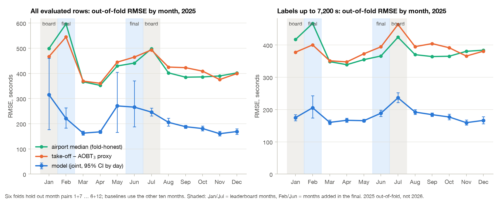
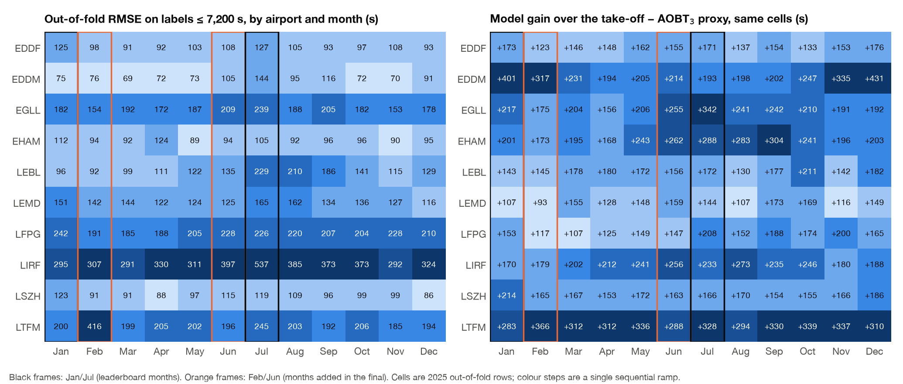

# Generalisation across calendar months (2025 out-of-fold)

The organiser's blind final scores January, February, June and July 2026. The
public leaderboard covered only January and July. This page asks what the model's
own 2025 cross-validation says about months it has never been scored on: every
2025 month was predicted out of fold (folds hold out month pairs 1+7, 2+8, 3+9,
4+10, 5+11 and 6+12, see [validation](validation.md#temporal-splits-and-integrity-checks)),
so February and June 2025 are a pseudo-final.

**What is measured.** The out-of-fold predictions are the E195 `joint` arm of the
current chain before E81 and the later tail steps (`data/e195_pre_e81_20261007_v2/predictions.parquet`),
the same file as the [airport table in validation](validation.md#2025-out-of-fold-rmse-by-airport):
2,084,921 evaluated rows, excluding the 126 LIRF rows of the fixed TabPFN tail
segment. "All rows" is the challenge metric on that set; "body" is the subset with
labels up to 7,200 s (2,084,448 rows). Confidence intervals are 95 % percentile
bootstraps that resample calendar days with replacement inside each group, so one
day's flights move together. All numbers are printed by
`scripts/generalisation_report.py` (`[G..]` lines) and stored in
`docs/tables/generalisation_*.csv`.

These are 2025 numbers. They are not a measurement of the 2026 final: inputs shift
between years (see "Reading across to 2026" below).

## Month groups

| Group | Rows | RMSE, all rows (s) | 95 % CI | RMSE, body (s) | 95 % CI | Labels > 4 h | SSE in the 10 largest rows |
|---|---:|---:|---|---:|---|---:|---:|
| Jan + Jul (leaderboard months) | 344,374 | 279.2 | 215.9 – 357.7 | 211.2 | 198.9 – 223.4 | 4 | 41.4 % |
| Feb + Jun (new final months) | 326,857 | 247.3 | 194.9 – 319.4 | 196.3 | 181.3 – 211.9 | 3 | 33.2 % |
| Other eight months | 1,413,690 | 192.7 | 174.7 – 220.7 | 172.4 | 169.5 – 175.4 | 4 | 18.0 % |

Feb + Jun minus Jan + Jul: −31.9 s on all rows (95 % interval −130.3 to +69.0 s)
and −14.9 s on the body (−33.5 to +6.9 s). The new months were not harder than the
leaderboard months in 2025; the intervals include zero, so the difference is not
established either. The all-rows intervals are wide because a handful of rows
dominate the squared error: ten rows hold 41 % of the Jan + Jul squared error.

## Month by month

Source: `docs/tables/generalisation_by_month.csv`.

| Month | Rows | Model, all rows (s) | 95 % CI | Model, body (s) | 95 % CI | Proxy, body (s) | Airport median, body (s) | Gain over proxy, body (s) |
|---|---:|---:|---|---:|---|---:|---:|---:|
| **Jan** | 153,700 | 315.2 | 177 – 460 | 175.0 | 165 – 185 | 377.9 | 417.1 | 202.9 |
| **Feb** | 143,727 | 221.0 | 183 – 263 | 205.6 | 174 – 243 | 400.4 | 467.0 | 194.8 |
| Mar | 164,445 | 162.7 | 155 – 171 | 160.3 | 154 – 168 | 351.2 | 348.4 | 190.9 |
| Apr | 175,281 | 167.8 | 162 – 174 | 166.7 | 161 – 173 | 347.7 | 339.1 | 181.0 |
| May | 185,196 | 270.9 | 166 – 404 | 165.5 | 162 – 170 | 372.9 | 354.7 | 207.4 |
| **Jun** | 183,130 | 266.1 | 188 – 370 | 188.7 | 179 – 198 | 394.4 | 366.0 | 205.7 |
| **Jul** | 190,674 | 246.4 | 231 – 262 | 236.3 | 222 – 252 | 463.6 | 424.2 | 227.3 |
| Aug | 191,165 | 205.6 | 191 – 223 | 192.2 | 185 – 200 | 395.1 | 370.2 | 202.9 |
| Sep | 183,935 | 188.3 | 183 – 194 | 184.2 | 179 – 190 | 404.4 | 364.3 | 220.2 |
| Oct | 185,669 | 180.9 | 172 – 192 | 176.9 | 168 – 186 | 391.5 | 365.3 | 214.6 |
| Nov | 162,328 | 160.5 | 152 – 170 | 159.4 | 152 – 168 | 365.9 | 380.5 | 206.5 |
| Dec | 165,671 | 169.1 | 158 – 180 | 166.4 | 156 – 178 | 380.9 | 384.0 | 214.5 |

Bold rows are the four months of the 2026 final. Baselines are fold-honest: the
airport median and the proxy offset for a held-out month pair are computed on the
other ten months. The proxy is take-off time minus AOBT_3 (the NM actual off-block
time), available on 98.93 % of rows; rows without an NM record fall back to the
airport median. A proxy with a per-airport median offset is also in the table
(`rmse_body_base_proxy_adj`); it is 10–26 s better than the raw proxy and changes
no conclusion.



Three observations:

- **Body RMSE is 159–206 s in eleven months and 236 s in July.** July has the
  largest label spread at LIRF (body RMSE 537 s), LEBL (229 s), EGLL (239 s) and
  EDDM (144 s). February (206 s) is the second-highest month and owes that to one
  airport, LTFM (417 s against 185–245 s in the other eleven months), which had a
  snow episode in February 2025 ([final-period analysis §A.6](../analysis/final_period_transfer_20261008.md)).
- **All-rows RMSE is driven by single rows in some months.** January 315 s against
  175 s on the body comes from two LFPG labels of 23 and 16 hours (the larger one
  holds 46 % of January's squared error; LFPG all-rows 796 s, body 242 s); May
  271 s against 166 s from one LSZH label of 24 h 16 min (56 % of May's squared
  error; LSZH 797 s against 97 s); June 266 s against 189 s from one LIRF label
  of 24 h 13 min (45 %; LIRF 768 s against 397 s). The day bootstrap shows this
  as intervals of ±100 s and more.
- **The gain over the baselines does not depend on the month.** The body gain over
  the raw proxy is 181–227 s in every month (Jan + Jul 216 s, Feb + Jun 201 s,
  other months 205 s); over the airport median 191–217 s per group. In no
  airport-month (0 of 120) is the model worse than the raw proxy.

## Airport by month

Source: `docs/tables/generalisation_by_airport_month.csv`.



Body RMSE across the twelve months, per airport (mean, range, coefficient of variation):

| Airport | Mean (s) | Min – max (s) | CV | Airport | Mean (s) | Min – max (s) | CV |
|---|---:|---|---:|---|---:|---|---:|
| EDDF | 103.3 | 90.5 – 126.9 | 0.12 | LEMD | 137.4 | 115.6 – 164.8 | 0.11 |
| EDDM | 88.1 | 68.7 – 144.0 | 0.27 | LFPG | 211.1 | 185.3 – 241.8 | 0.09 |
| EGLL | 186.7 | 152.8 – 238.7 | 0.13 | LIRF | 351.4 | 291.3 – 537.4 | 0.20 |
| EHAM | 98.1 | 89.2 – 124.1 | 0.11 | LSZH | 101.0 | 85.7 – 123.3 | 0.12 |
| LEBL | 138.8 | 92.1 – 229.1 | 0.33 | LTFM | 220.3 | 184.6 – 416.5 | 0.29 |

Six airports vary by 9–13 % around their mean; the unstable ones are LEBL and EDDM
(summer peaks in July–September), LTFM (February 2025 only) and LIRF (June–July).
For the final months specifically: in February the model's body RMSE is below its
annual mean at eight airports, 5 s above it at LEMD (142 vs 137) and far above it
at LTFM; in June it is above the mean at EDDF (108 vs 103), EDDM (105 vs 88), EGLL
(209 vs 187), LFPG (229 vs 211), LIRF (397 vs 351) and LSZH (115 vs 101), i.e.
June 2025 already shows part of July's summer pattern.

## What differs between months

Source: `docs/tables/generalisation_drivers_by_month.csv`. Own-track coverage is
the share of departures whose own aircraft was seen on the ADS-B surface feed,
from the production stage inputs (`codex_chain_diagnostic_20261004/residual_map.parquet`).

| Month | Label SD (s) | No-NM rows | SSE from no-NM rows | SSE from LIRF | Labels > 2 h | SSE from labels > 2 h | Own-track coverage | RMSE, NM rows (s) | RMSE, no-NM rows (s) |
|---|---:|---:|---:|---:|---:|---:|---:|---:|---:|
| Jan | 520 | 0.93 % | 71.1 % | 6.5 % | 23 | 69.2 % | 51.4 % | 170.3 | 2,759 |
| Feb | 615 | 0.77 % | 28.5 % | 16.7 % | 41 | 13.5 % | 52.8 % | 187.7 | 1,346 |
| Mar | 403 | 0.65 % | 8.3 % | 26.6 % | 27 | 2.9 % | 58.9 % | 156.3 | 578 |
| Apr | 385 | 0.61 % | 6.8 % | 32.3 % | 21 | 1.3 % | 57.6 % | 162.5 | 558 |
| May | 459 | 0.86 % | 64.7 % | 17.5 % | 33 | 62.7 % | 60.5 % | 161.8 | 2,346 |
| Jun | 479 | 1.36 % | 53.4 % | 66.8 % | 55 | 49.7 % | 63.5 % | 182.9 | 1,669 |
| Jul | 528 | 2.04 % | 27.2 % | 41.4 % | 85 | 8.0 % | 55.8 % | 212.4 | 899 |
| Aug | 438 | 1.21 % | 18.5 % | 39.5 % | 60 | 12.6 % | 59.4 % | 186.8 | 805 |
| Sep | 427 | 1.33 % | 13.3 % | 34.6 % | 38 | 4.4 % | 61.8 % | 176.5 | 597 |
| Oct | 427 | 1.03 % | 11.3 % | 34.5 % | 39 | 4.4 % | 65.7 % | 171.3 | 601 |
| Nov | 421 | 0.83 % | 8.4 % | 23.6 % | 19 | 1.4 % | 69.0 % | 154.2 | 512 |
| Dec | 431 | 0.99 % | 12.0 % | 27.3 % | 32 | 3.1 % | 67.5 % | 159.4 | 590 |

Across the twelve months (descriptive correlations on 12 points, not a causal
decomposition): body RMSE moves with the number of labels above two hours
(r = +0.89), the share of departures without an NM record (+0.79) and the label
standard deviation (+0.67); it moves against own-track ADS-B coverage (−0.45). The
all-rows RMSE correlates with these drivers less (+0.28 to +0.61) because single
rows dominate it. Rows without an NM record are 0.6–2.0 % of departures but hold
7–71 % of the monthly squared error; their RMSE is 500–2,800 s against 154–212 s
for NM rows. Own-track coverage is a 2025 property of the adsb.lol receivers:
LIRF had 0.3–1.2 % own-track coverage in January–April and 80–94 % in June–July;
LEMD 0–2 % in January–February, 76–98 % in March–June and September–December and
30–34 % in July–August.

## Is the neural weight tuned to January/July?

The final recipe and the best submission v12077 give the ordered-trajectory neural
member weight 0.35 in the regular candidate instead of the 0.25 of v12075
([model design](model-design.md#recording-regime-mixture)). The weight was chosen
on all twelve months of 2025, not on the leaderboard months: E212 recomputed the
exact out-of-fold chain up to E81 at weights 0.05–0.60 (step 0.05) with the
ten-seed member, and the table below gives the change of `decided`-row RMSE against
0.25 for each month of 2025 (source: `analysis/e212_nn_weight_10seed_20261008/per_month.json`,
[E212 report §6](../analysis/e212_nn_weight_10seed_20261008.md); journal 407a, 410, 425).

| Month | Best weight on the grid | ΔRMSE at 0.35 (s) | at 0.40 | at 0.45 | at 0.50 |
|---|---:|---:|---:|---:|---:|
| **Jan** | 0.40 | −0.117 | −0.141 | −0.117 | −0.077 |
| **Feb** | 0.60 | −0.675 | −0.957 | −1.172 | −1.344 |
| Mar | 0.55 | −0.449 | −0.595 | −0.717 | −0.793 |
| Apr | 0.35 | −0.108 | −0.104 | −0.057 | +0.016 |
| May | 0.45 | −0.198 | −0.249 | −0.266 | −0.265 |
| **Jun** | 0.40 | −0.140 | −0.160 | −0.140 | −0.093 |
| **Jul** | 0.35 | −0.107 | −0.104 | −0.049 | +0.051 |
| Aug | 0.30 | −0.024 | +0.016 | +0.114 | +0.238 |
| Sep | 0.35 | −0.108 | −0.100 | −0.037 | +0.063 |
| Oct | 0.35 | −0.121 | −0.116 | −0.051 | +0.059 |
| Nov | 0.35 | −0.123 | −0.123 | −0.072 | +0.033 |
| Dec | 0.50 | −0.349 | −0.441 | −0.472 | −0.474 |
| Months better than 0.25 | | **12 of 12** | 11 of 12 | 9 of 12 | 7 of 12 |

Bold rows are the four months of the 2026 final. The optimum by month ranges from
0.30 to 0.60: February, March and December, the months with reception gaps where
the neural member is relatively stronger than the trees, pull it up; summer pulls
it to 0.30–0.35. The registered leave-one-pair-out rule chose 0.40 (pooled
−0.228 s, better in all six pairs), but 0.40 is worse than 0.25 in August, and a
weight chosen on January–June (0.50) is worse than 0.25 on July–December
(+0.017 s). The weight 0.35 is the only grid value that improves on 0.25 in every
month of 2025, with the ten-seed member and with the three-seed member, and it is
not the January/July optimum (January prefers 0.40). It was fixed on this evidence
before the upload of v12077, which then measured −0.3371 s on January/July 2026
against the same file at 0.25 (v12076). The 2025 gain in the final's months is
−0.117 s (January), −0.675 s (February), −0.140 s (June) and −0.107 s (July); as
with the rest of this page these are 2025 numbers, not a measurement of 2026.

## Reading across to 2026

This section is an explanation, not a measurement. The
[final-period analysis](../analysis/final_period_transfer_20261008.md) compared
the 2026 final rows with 2025:

- The no-NM share in February 2026 (0.91 %) is close to February 2025 (0.77 %)
  and half of January 2026 (1.60 %); June 2026 (1.35 %) matches June 2025 (1.36 %).
  By the 2025 relationship above, that is the direction of a lower, not higher,
  error in February.
- LIRF departures without an NM record are 75 in February 2026 and 161 in June
  2026 against 107 and 276 in January and July; the February 2025 tail was more
  often a schedule copy (78 % of such rows) than in other months, which the
  regime mixture learned on all of 2025 may under-weight.
- LTFM February 2026 has no snow signature (share of take-off minus schedule
  above one hour 7.2 % against 12.9 % in February 2025), so the 417 s February
  2025 cell is not expected to repeat.
- ADS-B surface coverage in 2026 differs from 2025 by airport and month (LIRF
  78.5 % in January 2026, 6.2 % in July 2026; February and June 2026 coverage is
  only known from the downloaded surface files). The stage models were trained
  on 2025 coverage; the −0.45 correlation above says lower coverage goes with
  higher error, with a magnitude we have not measured on 2026 rows.

## Limitations

- The predictions are selection-informed out-of-fold estimates of the chain before
  E81, with upstream stages not fully nested through the chain; the limitations in
  [validation](validation.md#evidence-for-the-current-members) apply unchanged.
  The E203 member of v12075 is not in these predictions; the neural-weight table
  above comes from a separate recompute of the E203 chain (E212) on the same folds.
- The 126 excluded TabPFN rows hold 111 of the 122 labels above four hours in 2025;
  their treatment is a separate fixed step and is not measured here.
- Day-level bootstrap intervals capture within-month day-to-day variation only;
  they do not represent year-to-year drift in inputs, receivers or operations.
- Baselines use the fold-honest airport median and NM off-block time; a stronger
  baseline (for example per airport, hour and runway) would narrow the gain. The
  stability of the gain across months, not its size, is the point of the comparison.
- Twelve monthly points cannot separate correlated drivers (label spread, no-NM
  share, coverage, season); the correlations describe, they do not attribute.

## Reproduction

```
POLARS_MAX_THREADS=2 OMP_NUM_THREADS=2 .venv/bin/python scripts/generalisation_report.py --data-root data
```

Inputs: `data/e195_pre_e81_20261007_v2/predictions.parquet`, `data/features_fin1b.parquet`
and (optional) `data/codex_chain_diagnostic_20261004/residual_map.parquet`. Outputs:
`docs/tables/generalisation_by_month.csv`, `generalisation_month_groups.csv`,
`generalisation_by_airport_month.csv`, `generalisation_drivers_by_month.csv` and the
two figures above. Bootstrap seed 20261008, 1,000 replicates; runtime about one
minute on two threads.
