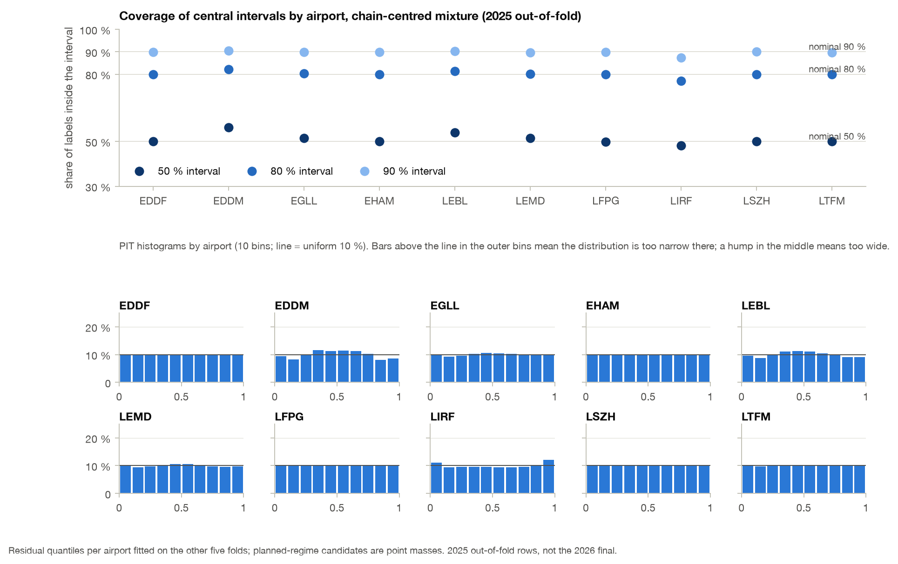

# Calibrated uncertainty from the regime mixture (2025 out-of-fold)

The point prediction of the base model is a mixture
([model design, recording-regime mixture](model-design.md)): a classifier gives
six regime probabilities over candidate values, and the prediction is the
probability-weighted mean. The same two arrays describe a full predictive
distribution per flight at no extra training cost. This page builds that
distribution, checks its calibration on the 2025 out-of-fold rows and provides a
function that returns per-flight quantiles. Everything is computed by
`scripts/uncertainty_report.py` (`[U..]` lines) from the stored out-of-fold arrays;
no model was trained.

## Construction

Classes follow `CLASSES` in `src/train.py`: `regular`, `sched`, `iobt`, `lobt`,
`eobt`, `dayshift`. For the four planned regimes the candidate is take-off time
minus the reported planning time; for `dayshift` it is the regular candidate plus
86,400 s. Infeasible candidates already carry probability zero in the stored arrays.
The predictive distribution of a flight at airport *a* is

    F(t) = sum over k >= 1 of p_k * 1[v_k <= t]  +  p_0 * G_a(t - c_0)

The planned regimes are point masses at their candidates. The regular regime is the
centre c_0 plus an empirical residual distribution G_a: the 99 percentiles (1 % to
99 %) of y − c_0 on flights whose true regime is regular, per airport. For the
out-of-fold evaluation the table of a held-out month pair is fitted on the other
five folds' rows only, so no flight's residual enters its own distribution. The
pooled table (all six folds) is the one to use on new rows.

Two centres are evaluated:

| Variant | Regular centre c_0 | Point forecast it matches | Point RMSE on the evaluated rows (s) |
|---|---|---|---:|
| `base` | `reg`, the base regressor inside the registered mixture (`data/cv_preds_fin1b_hz`) | the mixture mean `pred` | 240.16 |
| `chain` | the value that makes the mixture mean equal the production out-of-fold forecast `joint` (E195, chain before E81); falls back to `reg` on the 0.22 % of rows with p_regular < 0.2 | `joint` | 218.26 |

The `chain` variant keeps the downstream point refinement as the centre and
re-fits the residual table around it; its planned-regime masses are the base
classifier's. Rows: the 2,084,921 evaluated rows of
[validation](validation.md#2025-out-of-fold-rmse-by-airport).

Metrics: coverage of the central 50/80/90 % intervals (between the 25/75, 10/90
and 5/95 % quantiles); median interval width; the randomised probability integral
transform (PIT), which is uniform on [0, 1] for a calibrated distribution; and
CRPS, compared with the point forecast (whose CRPS equals its absolute error) and
with a fold-honest climatology (the 99 percentiles of the label itself at the
airport on the other folds).

## Results on all rows

Source: `docs/tables/uncertainty_coverage.csv`.

| Variant | Coverage 50 % | 80 % | 90 % | Below 5 % quantile | Above 95 % quantile | Median width 50 / 80 / 90 % (s) | CRPS (s) | Point MAE (s) | Climatology CRPS (s) | Skill vs point | Skill vs climatology |
|---|---:|---:|---:|---:|---:|---|---:|---:|---:|---:|---:|
| `base` | 49.7 % | 79.7 % | 89.6 % | 5.2 % | 5.1 % | 175 / 365 / 504 | 96.9 | 131.9 | 188.8 | 26.5 % | 48.7 % |
| `chain` | 51.0 % | 80.1 % | 89.7 % | 5.2 % | 5.1 % | 125 / 280 / 396 | 76.5 | 101.8 | 188.8 | 24.9 % | 59.5 % |

Both variants are calibrated on the whole set to within one point of nominal, with
symmetric tails. The chain variant is 23 % sharper (80 % interval 280 s against
365 s) at the same coverage, which is the downstream stages' point gain turned
into narrower intervals. PIT deciles on all rows (uniform = 10.0 each): `base`
10.2 / 9.9 / 9.9 / 9.9 / 9.9 / 9.9 / 10.0 / 10.0 / 10.1 / 10.2; `chain` 10.0 / 9.5 /
9.8 / 10.2 / 10.3 / 10.3 / 10.2 / 10.0 / 9.7 / 9.9.

The median of the distribution is not a better point forecast than the mean under
RMSE (chain: 223.1 s against 218.3 s), as expected for right-skewed residuals.

## By airport, regime and month (chain variant)



| Airport | Rows | Coverage 50 / 80 / 90 % | Median 80 % width (s) | CRPS (s) | Point MAE (s) | Skill vs point |
|---|---:|---|---:|---:|---:|---:|
| EDDF | 230,141 | 50.0 / 80.0 / 90.0 | 194 | 48.5 | 64.0 | 24.2 % |
| EDDM | 167,334 | 56.4 / 82.1 / 90.5 | 152 | 39.6 | 49.2 | 19.5 % |
| EGLL | 239,546 | 51.5 / 80.4 / 90.0 | 397 | 94.9 | 127.4 | 25.5 % |
| EHAM | 247,951 | 50.0 / 79.9 / 89.8 | 142 | 41.7 | 51.0 | 18.1 % |
| LEBL | 179,705 | 54.0 / 81.4 / 90.2 | 216 | 60.8 | 78.1 | 22.1 % |
| LEMD | 212,242 | 51.5 / 80.1 / 89.7 | 279 | 68.1 | 90.3 | 24.6 % |
| LFPG | 239,552 | 49.9 / 80.0 / 89.9 | 416 | 103.6 | 139.2 | 25.5 % |
| LIRF | 160,578 | 48.1 / 77.0 / 87.3 | 503 | 141.0 | 197.8 | 28.7 % |
| LSZH | 134,907 | 50.0 / 80.0 / 90.0 | 170 | 44.9 | 56.9 | 21.2 % |
| LTFM | 272,965 | 50.1 / 79.9 / 89.6 | 435 | 109.0 | 147.3 | 26.0 % |

Airports whose residual spread is stable through the year (EDDF, EHAM, LFPG, LSZH,
LTFM) are calibrated to within half a point; their PIT histograms are flat. EDDM and
LEBL are slightly too wide (50 % interval covers 56 % and 54 %; PIT humps in the
middle), because a single yearly residual table over-states the spread in their
quiet months. LIRF is too narrow (77 % and 87 % for the 80 % and 90 % intervals;
PIT mass in the outer bins) for the opposite reason: its June–July spread exceeds
the yearly table.

By true regime (chain variant):

| Regime | Rows | Coverage 50 / 80 / 90 % | Median 80 % width (s) | CRPS (s) | Point MAE (s) |
|---|---:|---|---:|---:|---:|
| regular | 1,944,039 | 50.7 / 80.0 / 89.8 | 272 | 75.3 | 99.5 |
| sched | 92,483 | 52.6 / 78.9 / 87.3 | 358 | 101.0 | 148.0 |
| eobt | 29,091 | 64.0 / 89.8 / 95.5 | 362 | 61.3 | 85.8 |
| iobt | 19,230 | 55.5 / 82.7 / 90.6 | 385 | 94.9 | 128.7 |
| lobt | 75 | 36.0 / 61.3 / 74.7 | 411 | 160.2 | 209.1 |
| dayshift | 3 | 0 / 0 / 0 | 2,058 | 54,583 | 55,505 |

The regular regime, 93.2 % of rows, is calibrated. Planned regimes are
over-covered where the classifier is confident (an interval that contains the
candidate point mass covers the label exactly), and under-covered for `lobt` and
`dayshift`, which the classifier almost never assigns: 75 and 3 rows, where the
distribution is as wrong as the point forecast.

By month (coverage of the 80 % and 90 % intervals, chain variant):

| | Jan | Feb | Mar | Apr | May | Jun | Jul | Aug | Sep | Oct | Nov | Dec |
|---|---:|---:|---:|---:|---:|---:|---:|---:|---:|---:|---:|---:|
| 80 % interval | 79.0 | 80.4 | 82.0 | 79.3 | 80.8 | 80.2 | 74.6 | 78.2 | 79.9 | 81.2 | 83.4 | 83.0 |
| 90 % interval | 89.0 | 89.9 | 91.3 | 89.6 | 90.6 | 89.9 | 85.6 | 88.5 | 89.5 | 90.4 | 91.7 | 91.4 |
| CRPS (s) | 77.9 | 80.2 | 70.4 | 73.8 | 73.4 | 77.7 | 92.0 | 81.5 | 77.1 | 73.4 | 68.6 | 70.0 |

Grouped: Jan + Jul 47.4 / 76.6 / 87.1 %, Feb + Jun 51.0 / 80.3 / 89.9 %, other
months 51.9 / 80.9 / 90.3 %. The two months added in the final are at nominal; July
is the only month more than 3 points below nominal, consistent with its larger
label spread ([generalisation](generalisation.md#month-by-month)).

Rows without an NM record (22,298; 1.07 %) are the one population where the
distribution fails: coverage 30.3 / 56.6 / 70.7 % with CRPS 224 s. The mixture has
no candidate for a missing planning time, and the airport residual table does not
know that the row lacks NM information; these rows need their own residual table
(not built here because the fixed TabPFN tail step covers the expensive part of
them separately).

## Function

`scripts/uncertainty_report.py` exposes

```python
from uncertainty_report import predictive_quantiles, fit_residual_table, chain_centre
q = predictive_quantiles(proba, values, airports, table, qs=(0.1, 0.5, 0.9))
```

`proba` and `values` are the `(n, 6)` arrays saved by `src/train.py` (fold files
or `submissions/parts_v*.npz`); `airports` the ICAO codes; `table` a dict
airport → 99 residual quantiles, either from `fit_residual_table` or read from
`docs/tables/uncertainty_residual_quantiles.csv` (`variant`, `airport`,
`fold_excluded`, `q`, `residual_s`; use `fold_excluded == 'none'` for the pooled
table). Pass `centre=chain_centre(proba, values, joint)` to centre on a chain
forecast. On a 5,000-row sample with the pooled chain table the function returns
a median of 890 s, a mean 80 % width of 312 s and a median RMSE of 196.8 s against
the labels.

## Limitations

- The residual table is conditioned on airport only; the PIT humps at EDDM and
  LEBL and the narrow tails at LIRF show that spread also depends on month, and
  the no-NM rows show it depends on information availability. A table keyed by
  airport × month or scaled by a learned spread would fix both and is an
  evaluation, not a model change.
- The planned-regime candidates are point masses, so coverage on those rows
  depends on the classifier's confidence rather than on a residual model; the
  ±6 s label tolerance of `regime_label` is not represented.
- The 99-point grid truncates the regular residual below its 1st and above its
  99th percentile, so the 90 % interval is exact but the CRPS slightly
  under-states tail error.
- The `chain` centre is an algebraic back-out of the production point forecast; it
  does not recover how the downstream stages redistributed regime mass. Results
  are 2025 out-of-fold rows of the chain before E81 with the limitations of
  [validation](validation.md#evidence-for-the-current-members); nothing here is
  measured on 2026 rows.

## Reproduction

```
POLARS_MAX_THREADS=2 OMP_NUM_THREADS=2 .venv/bin/python scripts/uncertainty_report.py --data-root data
```

Inputs: `data/cv_preds_fin1b_hz/fold_*.npz`, `data/features_fin1b.parquet`,
`data/e195_pre_e81_20261007_v2/predictions.parquet`. Outputs:
`docs/tables/uncertainty_coverage.csv`, `uncertainty_pit.csv`,
`uncertainty_residual_quantiles.csv` and the figure above. PIT randomisation seed
20261008; runtime under a minute on two threads.
